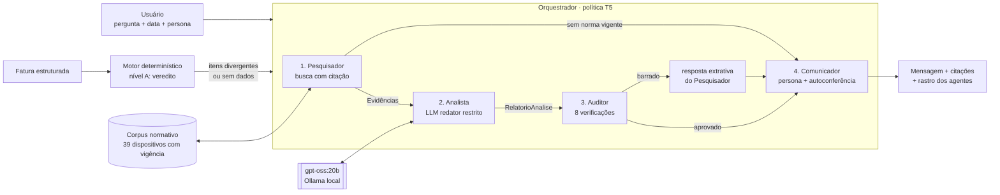
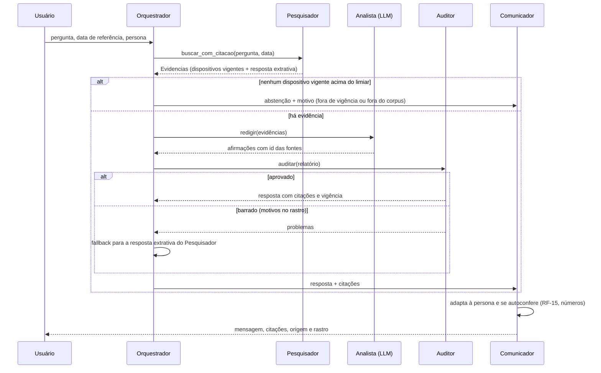
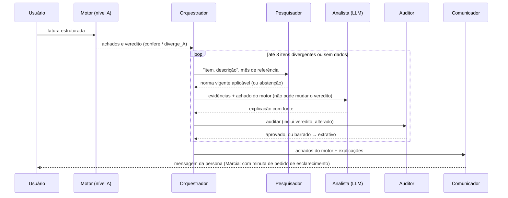

# Sistema multiagentes (F5, S4)

O Fatura Aberta tem **quatro agentes especializados**, coordenados por um **Orquestrador**:

| Agente | Papel | Usa LLM? |
|---|---|---|
| **Pesquisador** | recupera a norma vigente, com citação (Research Agent) | não |
| **Analista Normativo** | redige afirmações com fonte sobre a evidência recebida (Analysis Agent) | **sim** |
| **Auditor** | confere cada afirmação e barra o que não tem lastro (Validation Agent) | não (juiz opcional) |
| **Comunicador** | adapta a resposta aprovada ao público-alvo (Communication Agent) | não |

A regra que organiza a colaboração: **o LLM só redige; quem decide é determinístico.** O motor decide
o veredito da fatura, o Pesquisador decide se há norma vigente, o Auditor decide se o texto do LLM
pode sair. Essa divisão vem do resultado da S3 (o RAG extrativo e o motor venceram os testes com LLM)
e do B4 × B5 da S4 (o Auditor estrito eliminou afirmações sem suporte, mas abstinha demais).

!!! info "Onde está o código"
    `packages/agentes/src/fa_agentes/`: `pesquisador.py`, `analista.py`, `auditor.py`,
    `comunicador.py` e `orquestrador.py` (mais `linguagem.py` e `llm.py`). A busca vem de
    `packages/rag` (`IndiceHibrido`) e o veredito da fatura de `packages/motor` (`analisar_nivel_a`).
    Na API: `POST /perguntar` e as explicações dentro de `POST /analisar`.

## Diagrama da arquitetura



## Responsabilidades

### 1. Pesquisador (`pesquisador.py`)

| | |
|---|---|
| **Entrada** | uma consulta (a pergunta, ou "item. descrição" de um achado do motor) e a data de referência |
| **Faz** | busca híbrida (léxica + vetorial) com **filtro estrito de vigência** e subgrupo B1, top-5; descarta o que fica abaixo do limiar de abstenção (0,30); monta a resposta extrativa (trechos literais) |
| **Saída** | `Evidencias`: dispositivos vigentes com score, resposta extrativa e, se abstém, o motivo |
| **Diferencial** | diz **por que** abstém: "há norma no corpus, mas nenhuma vigente na data" × "o tema não está no corpus" |
| **Ferramenta da #38** | é a busca com citação usada pelos outros agentes, que não consultam o corpus diretamente |

### 2. Analista Normativo (`analista.py`)

| | |
|---|---|
| **Entrada** | as `Evidencias` do Pesquisador; no fluxo de fatura, também o achado do motor |
| **Faz** | pede ao LLM (temperatura 0, semente 42, saída em JSON com esquema) afirmações curtas que apontem os `id` dos dispositivos que as sustentam |
| **Saída** | `RelatorioAnalise`: afirmações propostas, com as citações copiadas dos dispositivos; no fluxo de fatura viram achados de **nível C** (norma com ato, dispositivo e vigência), porque o nível B é reservado à tabela tarifária da ANEEL |
| **Não faz** | não escreve citação (vem sempre do dispositivo recuperado); não usa conhecimento externo; no fluxo de fatura, **não refaz a conta nem muda o veredito** do motor |
| **Para sozinho** | sem evidência, não chama o LLM |

### 3. Auditor (`auditor.py`)

Confere cada afirmação do Analista, na ordem abaixo. Qualquer reprovação barra o rascunho inteiro.

| Verificação | Motivo registrado |
|---|---|
| A afirmação tem pelo menos uma fonte | `sem_citacao` |
| Todo `id` citado é um dispositivo realmente recuperado | `citacao_inventada` |
| O dispositivo estava vigente na data de referência | `fora_de_vigencia` |
| A citação copiada é a do dispositivo | `citacao_divergente` |
| Nenhuma expressão proibida pelo RF-15 (ilegalidade, restituição, ação judicial) | `linguagem_proibida` |
| Todo número da afirmação existe nas fontes, e pelo menos 60% das palavras de conteúdo também | `sem_suporte` |
| No fluxo de fatura: o texto não contradiz o veredito do motor | `veredito_alterado` (novo na S4) |
| O juiz LLM (se ligado) aprova; ele só pode rejeitar | `juiz_rejeitou` |

O juiz LLM fica desligado: foi reprovado na calibração (κ = 0,03 em 13/11; κ = −0,14 na metade retida
da recalibração de 18/11, PR #162).

### 4. Comunicador (`comunicador.py`)

| | |
|---|---|
| **Entrada** | a resposta aprovada (ou a extrativa, ou a abstenção) e a persona; no fluxo de fatura, os achados do motor e as explicações |
| **Faz** | reescreve para a [persona](../produto/personas.md): **Celina** (curta, linguagem simples e o que fazer), **Rafael** (item a item), **Márcia** (citação completa com vigência e minuta neutra de pedido de esclarecimento) |
| **Autoconferência** | antes de entregar, confere que o texto não tem expressão proibida pelo RF-15 e **não contém número que não estivesse na entrada**; se falhar, registra o motivo e entrega o texto original sem adaptação, **desde que o original não tenha expressão proibida**; se tiver, não o transcreve e entrega só as referências aos dispositivos |
| **Não faz** | não usa LLM (modelos de texto determinísticos), para não reabrir o risco que o Auditor fechou |

### Orquestrador (`orquestrador.py`)

Coordena os agentes nas duas tarefas e registra cada passo no **rastro** (`Passo`: agente, ação,
detalhe, duração). O rastro volta na resposta de `POST /perguntar` e aparece na demonstração.
`POST /analisar` não o devolve: a trilha da análise de fatura fica disponível em
`Orquestrador.analisar_fatura`.

**Política T5 (LLM como redator restrito):** se o Auditor barra o rascunho do Analista, o usuário
recebe a **resposta extrativa do Pesquisador**, e não uma abstenção. Se o trecho literal da norma tiver
termo vedado pelo RF-15 (por exemplo, "devolução em dobro"), sai só a referência ao dispositivo, sem
transcrever o trecho. Com essa exceção, o fluxo entrega pelo menos o que o RAG extrativo (o T2, vencedor
da S3) entregaria: as mesmas fontes, mas, no caso do termo vedado, só a referência em vez do texto. O LLM
só entra quando o texto dele passa em todas as verificações.

## Fluxo de interação

### Pergunta regulatória



### Conferência de fatura



**Colaboração em uma frase:** o Pesquisador traz a norma vigente, o Analista propõe o texto, o
Auditor só deixa passar o que tem fonte e lastro, e o Comunicador fala a língua de quem pergunta, sem
acrescentar fato. Os agentes não compartilham estado: os contratos entre eles são `Evidencias`,
`RelatorioAnalise`, `ResultadoAuditoria` e `Mensagem`, então cada um é testado e trocado em separado.

## Demonstração

`scripts/demonstrar_multiagentes.py` percorre cinco cenários e imprime o rastro de cada agente:

| Cenário | O que acontece |
|---|---|
| 1. Pergunta coberta pela norma | Pesquisador acha o art. 289; Analista redige; Auditor aprova; Comunicador escreve para a Celina |
| 2. Rascunho com número errado | Auditor barra por `sem_suporte`; o Orquestrador entrega a resposta extrativa (não abstém) |
| 3. Pergunta fora do corpus | Pesquisador abstém ("fora do corpus") e o LLM nem é chamado |
| 4. Data antes da vigência | Pesquisador abstém ("há norma, mas não vigente na data") |
| 5. Fatura com total divergente | motor dá `diverge_A`; agentes citam o art. 327; Comunicador escreve a minuta para a Márcia |

```bash
uv run python scripts/demonstrar_multiagentes.py                    # offline, Analista simulado
uv run python scripts/demonstrar_multiagentes.py --persona celina   # uma persona só
FA_LLM_PROVEDOR=ollama uv run python scripts/demonstrar_multiagentes.py --llm ollama
```

Pela API (com `uv run uvicorn fa_api.main:app`):

```bash
curl -s localhost:8000/perguntar -H 'content-type: application/json' -d '{"pergunta":"Posso ser cobrado pela média quando não conseguem ler o medidor?","data_referencia":"2026-11-09","persona":"celina"}'
```

!!! warning "O modo padrão da demo usa um LLM simulado"
    No modo `simulado`, o Analista é um cliente falso que copia a primeira frase do dispositivo
    (cenários 1 e 5) ou troca um número (cenário 2). Isso mostra a colaboração e as regras, não a
    qualidade de um modelo. A qualidade com o modelo local está no
    [relatório S4](../avaliacao/relatorio-s4.md).

## O que foi medido

Rodada de 18/11/2026, com o modelo local (`gpt-oss:20b`, temperatura 0, semente 42) e o corpus de 39
dispositivos. Detalhes, intervalos e limites no [relatório S4](../avaliacao/relatorio-s4.md#rodada-t5-sistema-multiagentes-corpus-de-39-dispositivos).

| Nas 120 perguntas | B4 (sem Auditor) | B5 (Auditor estrito) | T2 (só Pesquisador) | **T5 (4 agentes)** |
|---|---|---|---|---|
| Acerto [IC 95%] | 90,0% [84,2; 95,0] | 76,7% [69,2; 84,2] | 91,7% [86,7; 96,7] | **93,3% [88,3; 97,5]** |
| Respostas com afirmação sem suporte | 14,2% | 0% (por construção) | 0% (trecho literal) | 0% (por construção) |
| Violações do RF-15 | 2 | 0 | 0 | **0** |

- O T5 supera o B5 (23 × 3 perguntas, p = 8,8×10⁻⁵) e empata com o B4 e o T2 (diferenças não
  significativas). A política de fallback eliminou o custo do Auditor estrito.
- O LLM redigiu a resposta final em 79 das 120 perguntas; em 27 o Auditor barrou o rascunho e entrou o
  trecho extrativo; em 14 o Pesquisador absteve e o LLM nem foi chamado. 0 JSON inválido em 106 chamadas.
- Nas 200 faturas, o veredito é do motor (200/200); os agentes explicaram os 84 itens divergentes com
  norma citada, **nenhum rascunho contradisse o motor** e nenhuma mensagem teve termo vedado.

## Limitações conhecidas

- **Latência.** Com o LLM local, cada rascunho do Analista leva de 10 a 30 s; a API usa
  `FA_AGENTES_TIMEOUT_S` e, se estourar, entrega o nível A com aviso. A thread que estoura o tempo não é
  cancelada; `FA_AGENTES_CONCORRENCIA` limita quantas rodam ao mesmo tempo. Sem LLM configurado, o fluxo
  responde em milissegundos com a resposta extrativa.
- **Juiz LLM.** Reprovado na calibração; fica desligado.
- **Comunicador determinístico.** As mensagens seguem modelos de texto; a legibilidade com usuários
  reais (RNF-08) só é testada na S7.
- **Escopo.** Subgrupo B1 e as normas do corpus; fora disso, os agentes abstêm.
- **Fatura sintética.** O veredito vem do motor, cujo 100% no conjunto sintético é circular (S3).

## Pedido combinado: texto + PDF em `POST /perguntar` (S5-05, #184)

O mesmo endpoint aceita três modos, todos retrocompatíveis (`packages/contratos` não muda):

| Modo | Campos do pedido | `modo` na resposta |
|---|---|---|
| Pergunta isolada | `pergunta` | `texto` |
| Fatura confirmada | `pergunta` + `fatura` (contrato `Fatura`) | `fatura` |
| PDF | `pergunta` + `pdf_base64` (+ `correcoes` confirmadas pelo usuário) | `pdf` |

`fatura` e `pdf_base64` são excludentes; `correcoes` só vale com `pdf_base64` e aceita os campos
`distribuidora`, `grupo_tarifario`, `mes_referencia` (`AAAA-MM-DD`), `leitura_anterior`,
`leitura_atual`, `consumo_kwh`, `bandeira`, `aliquota_icms` (fração) e `total`, com números em
formato decimal (`"150.5"`). O PDF decodificado tem limite de `FA_PDF_MAX_BYTES` (5 MB).
Payload malformado devolve **422**; falha de leitura do PDF devolve **200** com abstenção.

```json
{
  "pergunta": "O consumo informado confere com as leituras do medidor?",
  "persona": "marcia",
  "pdf_base64": "<PDF em base64>",
  "correcoes": {"consumo_kwh": "150"}
}
```

Campos novos da resposta (todos com valor padrão): `modo`, `achados_motor` (nível A do motor),
`campos_fatura` (campos confirmados usados na análise, para a tela de confirmação) e `aviso`.
Nas falhas, `abstencao=true`, `origem` ∈ {`falha_extracao`, `agentes_indisponiveis`} e
`motivo_abstencao` ∈ {`pdf_invalido`, `pdf_sem_texto`, `extracao_falhou`, `correcao_invalida`,
`agentes_indisponiveis`}; com agentes fora do ar os `achados_motor` continuam na resposta. Sem
leituras suficientes para o assunto da pergunta, `motivo_abstencao="dados_insuficientes"`.

Fluxo sugerido para a tela S6-01: enviar `pdf_base64` → exibir `campos_fatura` → o usuário corrige →
reenviar com `correcoes` (ou enviar a `fatura` já confirmada). Toda saída textual passa pelo
verificador de linguagem do RF-15.
