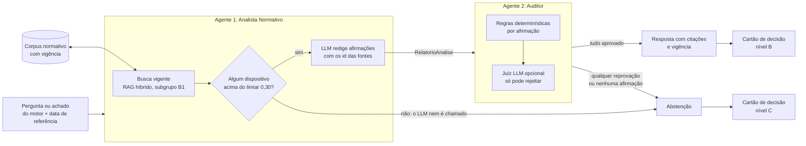
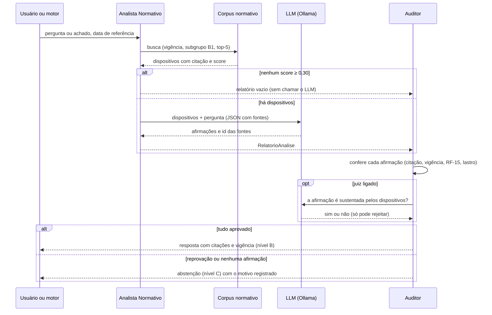

# Agentes (F5)

O Fatura Aberta tem **dois agentes especializados** que colaboram em sequência: o **Analista Normativo**
redige afirmações a partir das normas vigentes, e o **Auditor** confere cada afirmação e força a
abstenção quando falta suporte. O resto do sistema (extração, motor tarifário e busca) é determinístico e
fica fora dos agentes, porque o que dá para calcular com a própria fatura não passa por LLM.

!!! info "Onde está o código"
    `packages/agentes/src/fa_agentes/`: `analista.py`, `auditor.py`, `linguagem.py`, `llm.py` e
    `pipeline.py`. A busca vem de `packages/rag` (`IndiceHibrido`).

## Diagrama



## Responsabilidades

### Agente 1: Analista Normativo (`analista.py`)

| | |
|---|---|
| **Entrada** | uma pergunta ou um achado do motor, e a data de referência da fatura |
| **Faz** | busca os dispositivos **vigentes** na data (filtro estrito de vigência e subgrupo B1, top-5); descarta os abaixo do limiar de abstenção (0,30); pede ao LLM, com temperatura 0, afirmações curtas em JSON que apontem os `id` dos dispositivos que as sustentam |
| **Saída** | `RelatorioAnalise`: a consulta, os dispositivos recuperados e as `Afirmacao` propostas |
| **Não faz** | não escreve citação: a `Citacao` de cada afirmação é copiada do dispositivo recuperado, nunca do texto do modelo. Não usa conhecimento externo, não qualifica uma cobrança como ilegal, não estima restituição |
| **Quando para sozinho** | se nenhum dispositivo vigente passa do limiar, devolve um relatório vazio e **não chama o LLM** |

### Agente 2: Auditor (`auditor.py`)

| | |
|---|---|
| **Entrada** | o `RelatorioAnalise` do Analista |
| **Faz** | confere cada afirmação com regras determinísticas; opcionalmente, um juiz LLM revisa o que passou |
| **Saída** | `ResultadoAuditoria`: a resposta final (`Resposta`), as afirmações aprovadas e a lista de `Problema` com o motivo de cada reprovação |
| **Política** | **estrita**: se qualquer afirmação reprova, ou se não sobra nenhuma, a resposta final vira abstenção |
| **Não faz** | o juiz LLM só pode rejeitar, nunca aprovar sozinho; um juiz que devolve algo ilegível não aprova |

As verificações do Auditor, na ordem em que cada afirmação é conferida:

| Verificação | Motivo registrado |
|---|---|
| A afirmação tem pelo menos uma fonte | `sem_citacao` |
| Todo `id` citado é um dispositivo realmente recuperado | `citacao_inventada` |
| A citação copiada é a do dispositivo | `citacao_divergente` |
| O dispositivo estava vigente na data de referência | `fora_de_vigencia` |
| Nenhuma expressão proibida pelo RF-15 (ilegalidade, restituição, ação judicial) | `linguagem_proibida` |
| Todo número da afirmação existe nas fontes, e pelo menos 60% das palavras de conteúdo também | `sem_suporte` |
| O juiz LLM (se ligado) aprova | `juiz_rejeitou` |

### Componentes que não são agentes

| Componente | Papel |
|---|---|
| Motor tarifário (`packages/motor`) | achados determinísticos de nível A, a partir da fatura |
| Busca com citação (`packages/rag`) | corpus normativo com vigência, busca híbrida (léxica e vetorial) |
| Verificador de linguagem (`linguagem.py`) | regras do RF-15, usadas pelo Auditor |
| Cliente de LLM (`llm.py`) | Ollama local (`gpt-oss:20b` como gerador, `qwen3:14b` como juiz; ver [ADR-002](decisoes/adr-002-llm-local.md)) ou cliente falso, usado no CI |

## Fluxo de interação



**Colaboração em uma frase:** o Analista propõe, e o Auditor só deixa passar o que tem fonte vigente e
lastro no texto da norma. Os dois não compartilham estado: o contrato entre eles é o `RelatorioAnalise`,
então cada um pode ser testado e substituído separadamente.

## Os quatro desfechos

A demonstração (`scripts/demonstrar_agentes.py`) percorre quatro situações:

| Situação | O que acontece |
|---|---|
| Pergunta coberta pela norma | o Analista redige, o Auditor aprova, a resposta traz a citação e a vigência |
| Afirmação com erro (por exemplo, um percentual que não está no dispositivo) | o Auditor reprova por `sem_suporte` e a resposta vira abstenção |
| Pergunta fora do corpus | nenhum dispositivo passa do limiar e o LLM nem é chamado |
| Data sem norma vigente | o filtro de vigência não devolve nada e a resposta é abstenção |

Para rodar:

```bash
uv run python scripts/demonstrar_agentes.py                  # offline, Analista simulado
uv run python scripts/demonstrar_agentes.py --llm ollama     # com o modelo local
```

!!! warning "O modo padrão da demo usa um LLM simulado"
    No modo `simulado`, o Analista é um cliente falso que copia um trecho do dispositivo (cenário 1)
    ou erra um número de propósito (cenário 2). Isso mostra a colaboração e as regras do Auditor, não a
    qualidade de um modelo. O modo `--llm ollama` usa o `gpt-oss:20b` e exige o modelo baixado.

## O que foi medido

A rodada da S4 comparou, nas 120 perguntas do golden set, o **B4** (Analista sem Auditor) e o **B5**
(Analista seguido do Auditor). Detalhes, intervalos e limitações no
[relatório S4](../avaliacao/relatorio-s4.md).

| Medida | B4 | B5 |
|---|---|---|
| Acerto | 91,7% | 77,5% |
| Respostas com afirmação sem suporte | 15,0% | 0,0% (por construção) |

O Auditor eliminou as afirmações sem suporte, mas ao custo de **14,2 pontos de acerto** (17 perguntas
perdidas, nenhuma ganha). Pelo gate da S4, **o B5 não passa e o B4 é a arquitetura do produto**. A
leitura honesta do resultado:

- a perda vem sobretudo de **falsos positivos de regras do Auditor**: 12 dos 17 casos pela regra de
  números (que ignora o número do ato na citação, como "REN 1.000/2021, art. 323"), 3 por linguagem
  proibida ("devolução em dobro" é o termo literal do art. 323, § 2º) e 2 por id de citação inventado;
- o 0% do B5 vale por construção e não prova que o B5 seja melhor;
- o corpus da rodada tinha 28 dispositivos; o corpus atual tem 39, e a rodada precisa ser repetida;
- a anotação das falhas foi feita pelo agente, não por humanos.

## Limitações conhecidas

- **API.** A API tem o ponto de extensão com limite de 15 s e queda graciosa, e preserva os achados de
  nível A se os agentes falham. Hoje `analisar_com_agentes` devolve lista vazia: os agentes rodam no
  pipeline e na avaliação, mas ainda não alimentam o endpoint `/analisar`.
- **Juiz LLM.** O juiz foi reprovado na calibração da S3 (κ = 0,03) e não é usado nas rodadas.
- **Escopo.** O Analista cobre o subgrupo B1 e as normas do corpus; fora disso, abstém.
