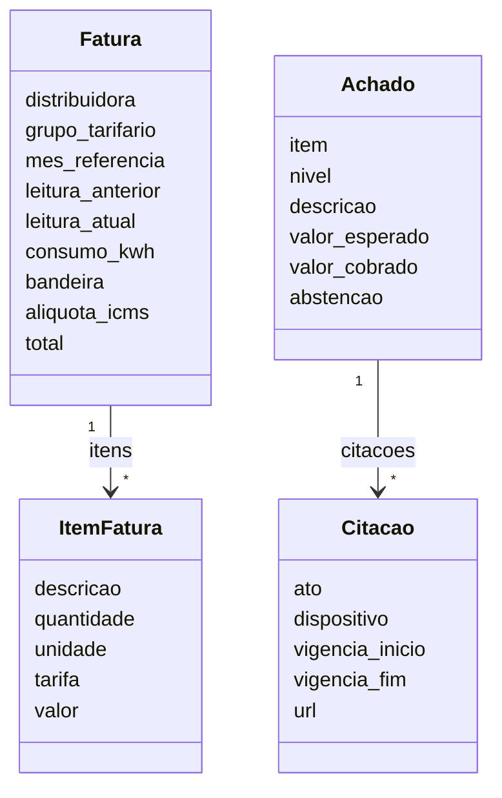

# Contratos

Os contratos ficam em `packages/contratos` (Pydantic v2) e são o idioma comum entre as frentes. Os modelos são **imutáveis** e **rejeitam campos desconhecidos**.

!!! warning "Mudança de contrato"
    Toda mudança em `packages/contratos/` usa a label `contrato` e exige **2 aprovações**. A v1 será congelada na Sprint 2.

## Modelos

!!! nivel-a "Nível"
    `Achado.nivel` é um enum com exatamente `A`, `B` e `C`.

## Privacidade

`Fatura` **não tem** campos para nome, endereço ou número da instalação. Esses dados são descartados na extração (F4) e não trafegam entre as frentes.

## Pendências

- TODO: decidir com as frentes se achados de nível B devem exigir citação ou fonte da tabela no próprio contrato.
- TODO: representação da fonte e data da tabela tarifária (hoje cabe em `Citacao`).
