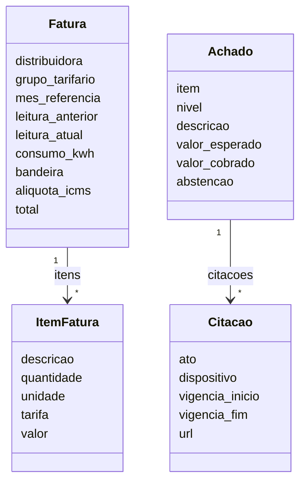

# Contratos

Os contratos ficam em `packages/contratos` (Pydantic v2) e são o idioma comum entre as frentes. Os modelos são **imutáveis** e **rejeitam campos desconhecidos**.

!!! warning "Mudança de contrato"
    Toda mudança em `packages/contratos/` usa a label `contrato` e exige **2 aprovações**. A versão `1.0.0` (`contratos-v1`) foi congelada na Sprint 2 (`S2-01`).

## Modelos

!!! nivel-a "Nível"
    `Achado.nivel` é um enum com exatamente `A`, `B` e `C`.

## Privacidade

`Fatura` **não tem** campos para nome, endereço ou número da instalação. Esses dados são descartados na extração (F4) e não trafegam entre as frentes.

## Decisões de congelamento (`contratos-v1`)

1. **Versão congelada:** `fa_contratos.__version__ == "1.0.0"` e `CONTRATO_VERSAO == "contratos-v1"`.
2. **Obrigatoriedade de citação no Nível B (`RF-09/10/11` e `RNF-04`):** Todo `Achado` com `nivel=Nivel.B` e `abstencao=False` exige ao menos uma `Citacao` em `Achado.citacoes`. A validação é imposta diretamente no modelo Pydantic (`_nivel_b_exige_citacao_oficial`).
3. **Representação da tabela tarifária oficial:** A fonte e o período de validade da tabela tarifária oficial da ANEEL são representados por `Citacao` (`ato` identificando a Resolução Homologatória da ANEEL, `dispositivo` indicando a tabela/anexo tarifário B1, `vigencia_inicio`, `vigencia_fim` e `url` oficial).
4. **Imutabilidade e rejeição de campos extras:** Todos os contratos herdam de `ModeloBase` (`extra="forbid"`, `frozen=True`), garantindo que erros de digitação ou campos de dados pessoais sejam rejeitados imediatamente na fronteira entre as frentes (`F2`, `F3`, `F4`, `F5` e `F6`).
