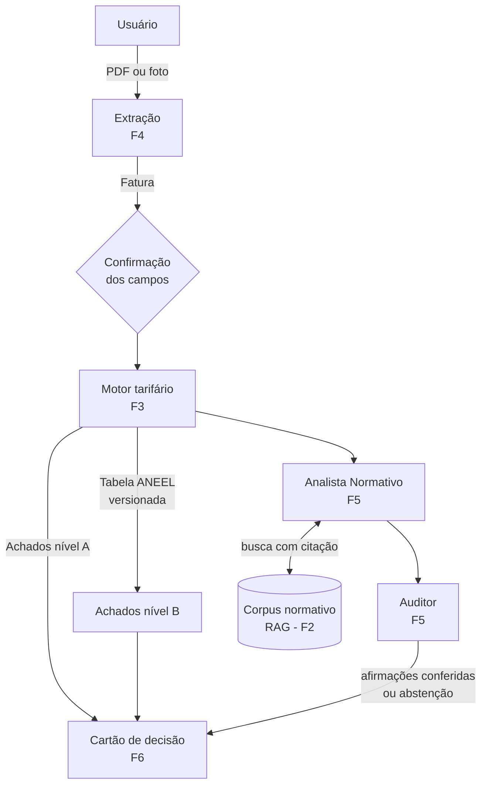

# Arquitetura

## Visão geral

A arquitetura mínima combina um **pipeline determinístico** (extração, depois motor tarifário) com **dois agentes**: o Analista Normativo, que busca e cita normas via RAG, e o Auditor, que confere as afirmações e força a abstenção quando não há suporte.

!!! info "Multimodal"
    PDF e foto da fatura. Para foto, um VLM local extrai os campos e o usuário os confirma antes da análise.

## Pacotes

| Pasta | Frente | Papel |
|---|---|---|
| `packages/contratos` | todas | Modelos Pydantic compartilhados |
| `packages/rag` | F2 | Corpus normativo e busca com citação |
| `packages/motor` | F3 | Checagens determinísticas (níveis A e B) |
| `packages/extracao` | F4 | PDF e foto para `Fatura` |
| `packages/agentes` | F5 | Analista Normativo e Auditor |
| `apps/api` | F6 | API FastAPI |
| `apps/web` | F6 | Web app Next.js (esqueleto) |
| `avaliacao` | F5 | Harness B1–B5 |

## Princípios

1. **Determinístico primeiro.** O que dá para calcular com a própria fatura não passa por LLM.
2. **Citação ou abstenção.** Afirmação normativa sem citação com vigência não sai.
3. **Privacidade por construção.** O contrato `Fatura` nem tem campos para dados pessoais.

## Mais detalhes

- [Contratos](contratos.md)
- [Decisões (ADRs)](decisoes/index.md)
