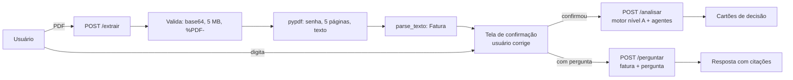

# Processamento multimodal: texto e PDF (S5)

Este documento descreve **o que o produto aceita hoje**, com os limites lidos do código, o que ele
**não** aceita e como cada falha é tratada. A demonstração reproduzível está em
[Demonstração da S5](../operacao/demo-s5.md).

## Modalidades suportadas

| Modalidade | Como entra | Onde está o código |
|---|---|---|
| **Texto** | Campo "Sua pergunta" na tela (ou `pergunta` no JSON) | `apps/api/src/fa_api/main.py` (`PedidoPergunta`) |
| **PDF digital** (com texto selecionável) | Botão "Enviar o PDF da fatura" (ou `pdf_base64` no JSON) | `main.py` (`/extrair`, `_extrair_fatura`), `packages/extracao/src/fa_extracao/` |
| **Dados digitados** | Formulário de confirmação | `apps/web/app/components/FaturaAberta.tsx` |

Texto e PDF alimentam a **mesma análise**: a pergunta é respondida sobre os campos confirmados da
fatura, com os achados do motor e a norma citada (`Orquestrador.responder_sobre_fatura`).

## Limites de entrada

| Limite | Valor padrão | Variável | O que acontece ao exceder |
|---|---|---|---|
| Tamanho do PDF | 5 MB (já decodificado) | `FA_PDF_MAX_BYTES` | HTTP 422 |
| Páginas do PDF | 5 | `FA_PDF_MAX_PAGINAS` | `motivo: pdf_muitas_paginas` |
| Formato | começa com `%PDF-` | – | HTTP 422 |
| Pergunta | 3 a 500 caracteres | – | HTTP 422 |
| Tempo dos agentes | 15 s | `FA_AGENTES_TIMEOUT_S` | resposta de abstenção com os achados do motor |
| Análises simultâneas dos agentes | 2 | `FA_AGENTES_CONCORRENCIA` | quem espera gasta o próprio prazo |

Não há limite de taxa (rate limit) implementado. O parser lê apenas faturas **Neoenergia Brasília,
grupo B1**, no layout coberto pelos testes de `packages/extracao`; outro layout cai em
`extracao_falhou`.

## Pipeline

1. **Entrada e validação.** `PedidoExtracao` e `_validar_pdf_base64` (`main.py`): base64 válido,
   tamanho e assinatura.
2. **Extração.** `_extrair_fatura`: `pypdf.PdfReader` verifica senha e páginas;
   `fa_extracao.pdf.extrair_texto` lê o texto; `fa_extracao.parse_texto` monta a `Fatura`
   (`fa_contratos`, sem campos de nome, endereço ou instalação).
3. **Confirmação.** A API **não analisa** nada em `/extrair`. A tela preenche o formulário e o
   usuário confere e corrige.
4. **Análise.** `/analisar`: `fa_motor.analisar_nivel_a` + explicações dos agentes (nível C).
   `/perguntar`: `Orquestrador.responder_sobre_fatura` (Pesquisador → Analista → Auditor →
   Comunicador, ver [Agentes](agentes.md)).
5. **Saída.** Cartões de decisão e cartão "Resposta à sua pergunta"; toda saída passa pelo
   verificador do RF-15 (`_sanitizar_saida`).

## O que não é suportado

- **PDF escaneado ou foto de PDF** (sem camada de texto): não há OCR. Falha com `pdf_sem_texto`.
- **Imagem e foto da fatura / VLM:** fora do entregável acadêmico atual (ver decisão abaixo).
- **PDF protegido por senha:** não é aberto (`pdf_protegido`).
- **Outras distribuidoras, grupos tarifários e layouts:** fora do escopo do MVP.
- **Áudio e vídeo:** fora de escopo.

## Casos de falha e mitigações

| Cenário | Sintoma retornado | Comportamento do sistema | Mitigação |
|---|---|---|---|
| Arquivo que não é PDF, ou base64 inválido | HTTP 422; a tela mostra "não parece um PDF válido" | Nada é lido nem analisado | Enviar o PDF original ou digitar os dados |
| PDF acima de 5 MB | HTTP 422 (a tela avisa antes de enviar) | Rejeitado | Enviar só as páginas da fatura |
| PDF corrompido | `motivo: pdf_invalido` | Mensagem clara, sem achados, sem conclusão | Gerar o PDF de novo |
| PDF protegido por senha | `motivo: pdf_protegido` | Mensagem clara | Enviar cópia sem proteção |
| Mais de 5 páginas | `motivo: pdf_muitas_paginas` | Mensagem clara | Enviar só as páginas da fatura |
| PDF escaneado, sem texto | `motivo: pdf_sem_texto` | Orienta a entrada manual | Digitar os dados (não há OCR) |
| Layout não reconhecido / campo obrigatório ausente | `motivo: extracao_falhou` | Mensagem clara | Digitar os dados |
| Campo lido errado | – | Usuário corrige na confirmação (ou `correcoes` na API) | Conferir o formulário antes de confirmar |
| Correção inválida (`correcoes`) | `motivo_abstencao: correcao_invalida`, só os nomes dos campos | Abstenção; valor digitado não é repetido | Corrigir o formato |
| Pergunta fora do alcance dos dados (ex.: sem leituras) | `motivo_abstencao: dados_insuficientes` | Abstenção explicando o que falta | Completar os campos e perguntar de novo |
| Sem norma vigente para o ponto | `abstencao` com a conferência do motor | Não inventa fundamento | Pedir esclarecimento à distribuidora |
| Agentes lentos ou fora do ar | `origem: agentes_indisponiveis`, `aviso`, `abstencao: true` | `achados_motor` preservados; `/analisar` devolve o nível A com `aviso` | Tentar de novo; o nível A segue válido |
| Texto de saída com termo vedado (RF-15) | Texto substituído por aviso neutro | Nunca sai ao cliente | Ajustar a redação na origem |
| Instrução de controle no PDF ou na pergunta | `instrucao_controle` | PDF recusado ou pergunta abstida antes dos agentes; achados A/B preservados para pergunta hostil | Remover a instrução e reenviar; ver [bateria S5-03](../seguranca/injecao-por-imagem.md) |
| API fora do ar | A tela avisa que não conseguiu falar com a API | Dados digitados continuam na tela | Subir a API e tentar de novo |

## Privacidade e tratamento de dados

- O PDF e o texto extraído ficam **só em memória** durante a requisição: não são gravados em disco
  nem em banco. Não há histórico no servidor.
- Os logs registram apenas o **tipo** do erro, nunca conteúdo de fatura; as mensagens de erro do
  parser não repetem valores (`packages/extracao/src/fa_extracao/erros.py`).
- As respostas levam `Cache-Control: no-store`.
- O contrato `Fatura` não tem campos de nome, endereço, CPF ou número da instalação; esses dados
  são descartados na extração.
- A **demonstração usa só dados sintéticos**: PDF gerado por script, valores fictícios, nenhum dado
  pessoal e nenhuma fatura real no repositório (`scripts/bloquear_binarios.py` barra PDFs fora de
  `docs/assets/` e do benchmark sintético).

## Decisões e pendências

- **Imagem e VLM ficam fora do entregável acadêmico atual** (texto + PDF digital). Não há extração
  de foto no produto.
- **Gate S5-02 (#41, acerto ≥ 90% em 40 fotos) e S5-01 (#40, extração de foto via VLM local)
  seguem pendentes.** Em `docs/sprints/s5.md` os critérios do gate ainda estão como TODO; nenhum
  resultado de medição foi registrado. Se o gate falhar, o plano de contingência já previsto é
  OCR mais formulário de confirmação.
- A tela de envio de PDF e pergunta é uma versão mínima, criada para esta demonstração; o
  acabamento da interface continua na S6-01 (#43). O limite de páginas, a assinatura do arquivo e
  o endpoint `/extrair` atendem parte da S6-06 (#179).
