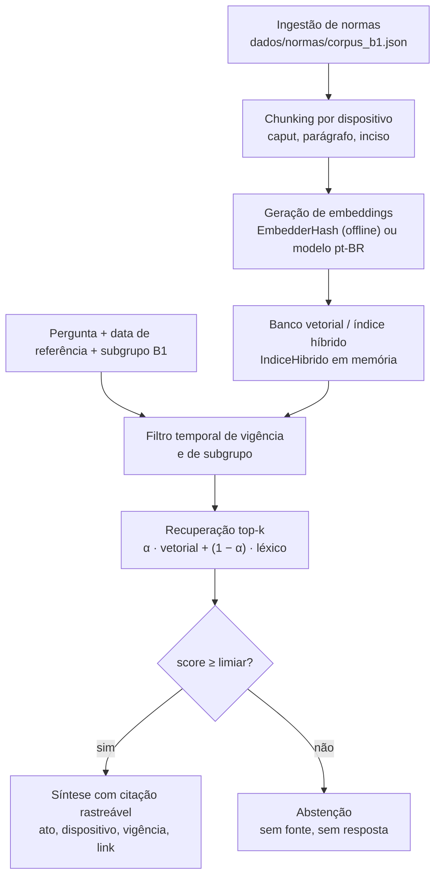

# RAG normativo (F2)

O RAG da Fatura Aberta recupera **dispositivos** de normas públicas vigentes e só responde com o que
recuperou. Quando nenhum dispositivo cobre a pergunta, o sistema se abstém.

## Arquitetura



## Pipeline de ingestão, ponta a ponta

1. **Curadoria.** Cada dispositivo é transcrito do texto oficial e conferido. O item guarda `id`,
   `titulo`, `texto`, `citacao` (`ato`, `dispositivo`, `vigencia_inicio`, `vigencia_fim`, `url`),
   `subgrupos`, `tags`, `conferido`, `conferido_em` e `fonte_conferencia`. Itens que não foram
   conferidos ficam como `"A verificar"` e **não entram no índice**.
2. **Carga.** `fa_rag.carregar_corpus()` valida cada citação com o contrato `Citacao`, recusa campos
   faltando e ids repetidos.
3. **Chunking.** `chunkar_dispositivo()` quebra em caput, parágrafos (`§ nº` e `Parágrafo único.`) e
   incisos. Cada chunk herda a citação com o dispositivo refinado (por exemplo, `art. 323, § 2º`).
4. **Embeddings.** `criar_embedder()` escolhe o extrator por `FA_RAG_EMBEDDER` (padrão `hash`).
5. **Índice.** `IndiceHibrido.do_corpus()` guarda os vetores normalizados e as frequências de termos.
6. **Consulta.** `buscar(consulta, data_referencia=..., subgrupos={"B1"})` filtra, ordena e devolve
   `ResultadoBusca` com `score`, `score_vetorial` e `score_lexico`.
7. **Síntese.** `responder()` monta o texto só com trechos literais dos chunks recuperados.

Para ver tudo funcionando: `.venv/bin/python scripts/demonstrar_rag.py`.

## Estratégia de chunking

O chunk é o **dispositivo**, não uma janela de caracteres. Uma janela de 400 caracteres cortaria um
inciso pela metade ou misturaria o caput de um artigo com o parágrafo de outro, e a citação deixaria
de apontar para um lugar exato da norma.

- **Valor probatório.** Um achado nível B precisa citar ato, dispositivo e vigência. Com um chunk por
  artigo, parágrafo ou inciso, a citação do resultado é exatamente a do trecho que o sustenta.
- **Incisos e alíneas ficam com o caput ou o parágrafo**, porque sozinhos perdem o sentido (“I - 3 dias
  úteis” só faz sentido sob “antecedência de pelo menos”).
- **Vigência por dispositivo.** Cada chunk filtra pela vigência da própria citação.
- **Literalidade.** Os chunks, juntos, reproduzem o texto do dispositivo sem alteração (há teste).

## Estratégia de embeddings

| Aspecto | `EmbedderHash` (padrão do CI) | Modelo multilíngue pt-BR (extensão) |
|---|---|---|
| Dimensão | 384, fixa | 384 a 1024, conforme o modelo |
| Como funciona | hashing de unigramas, bigramas e trigramas de caracteres, com blake2b | rede neural pré-treinada |
| Semântica | só sobreposição lexical e morfológica | captura sinônimos e paráfrases |
| Rede e custo | nenhum; roda offline | download do modelo ou chamada de API |
| Latência | microssegundos por texto | dezenas de ms em CPU, mais com API |
| Determinismo | total | depende de versão do modelo |

O padrão é o hashing porque o CI não pode depender de rede, e porque o resultado precisa ser
reprodutível. O custo é recall menor em perguntas em linguagem de usuário. Um modelo pt-BR entra
implementando o protocolo `Embedder` (`dim` e `embed(textos)`), sem mudar o resto do pacote. **Não há
modelo semântico medido neste repositório**; qualquer ganho esperado é hipótese até a rodada de
avaliação.

Os vetores são L2-normalizados, então o cosseno é o produto interno. Como os pesos do hashing não são
negativos, o cosseno fica em [0, 1].

## Busca híbrida

```
score = α · score_vetorial + (1 − α) · score_léxico        (α padrão = 0,5)
```

- `score_vetorial`: cosseno entre consulta e chunk.
- `score_léxico`: cobertura dos termos da consulta ponderada por IDF, em [0, 1]. Um termo que não
  existe no corpus pesa contra, e por isso uma pergunta fora do assunto tem score baixo.
- **Filtros estritos antes do ranking**: `vigente_em(data_referencia)` e interseção com o subgrupo
  (`B1`). Chunk sem subgrupo declarado não passa.
- `filtrar_vigencia=False` reproduz o baseline B2 da avaliação (RAG sem filtro de vigência).

## Resposta fundamentada e abstenção

`responder()` aceita apenas resultados com `score ≥ 0,30` (limiar inicial, a calibrar na S3), transcreve
o trecho literal e anexa as citações. Abaixo do limiar a resposta é uma abstenção fixa. O texto nunca
usa “ilegal” e nunca calcula valor de ressarcimento.

## Limitações conhecidas

- O corpus tem apenas dispositivos conferidos: REN ANEEL nº 1.000/2021 e CDC. PRODIST Módulo 8, a
  Resolução Homologatória de tarifas e a lei distrital de iluminação pública estão em
  [`dados/normas/README.md`](https://github.com/grupo-8-residencia/Fatura-Aberta/blob/dev/dados/normas/README.md)
  como `A verificar`.
- A data `vigencia_inicio` é a da entrada em vigor do ato. Dispositivos alterados depois têm a nota
  correspondente em `observacoes`.
- O limiar de abstenção e o α ainda não foram calibrados com o golden set.
