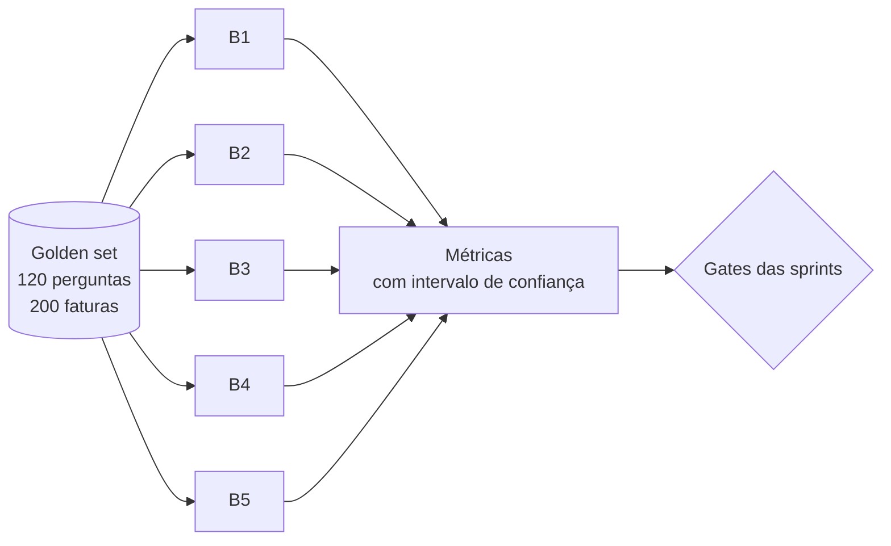

# Avaliação: protocolo B1–B5

O produto é tratado como um experimento: comparamos cinco baselines sobre o mesmo conjunto congelado (golden set).

| Baseline | Descrição |
|---|---|
| **B1** | Motor determinístico |
| **B2** | LLM com RAG, sem filtros de vigência |
| **B3** | LLM com RAG, com filtros de vigência |
| **B4** | Agente único |
| **B5** | Analista Normativo + Auditor |

## Gates ligados ao experimento

- **S2:** recall@5 ≥ 0,70 em 30 perguntas.
- **S3:** resultados de B2 e B3 com intervalo de confiança (resultado negativo também vale).
- **S4:** B5 ≥ B4 em afirmações sem suporte; senão B4 vira o produto e o achado entra no relatório.

## Regras

- O golden set é congelado (hash registrado) antes das rodadas.
- Só dados sintéticos ou anonimizados.
- Resultados negativos são reportados.

## Pendências

- TODO: método do intervalo de confiança.
- TODO: protocolo do juiz LLM e calibração contra 40 itens humanos.
- TODO: como os baselines são executados (um comando por rodada).

Veja [métricas](metricas.md) e [resultados](resultados.md).
