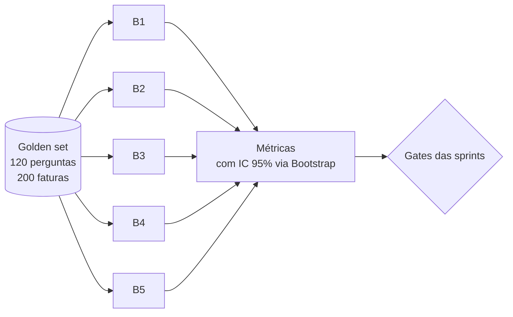

# Avaliação: protocolo B1–B5

O produto é tratado como um experimento científico controlado: comparamos cinco baselines arquiteturais sobre o mesmo conjunto congelado (*golden set* de 120 perguntas regulatórias e 200 faturas sintéticas/anonimizadas).

## Especificação detalhada dos baselines

| Baseline | Nome | Arquitetura e componentes | Hipótese testada |
|---|---|---|---|
| **B1** | **Motor determinístico puro** | Executa exclusivamente o pacote `fa_motor` (regras aritméticas de Nível A e confronto tarifário de Nível B contra tabelas ANEEL versionadas), sem chamada a LLM. | Delimita o piso determinístico com zero alucinação e zero falsos alarmes em faturas aritmeticamente consistentes. |
| **B2** | **LLM com RAG ingênuo (sem filtro de vigência)** | Recupera os $k=5$ dispositivos mais similares por busca híbrida em `fa_rag` **sem** filtrar por `vigencia_inicio`/`vigencia_fim` na data da fatura e gera o cartão com uma chamada única ao LLM. | Mede a degradação causada por citações de resoluções revogadas (ex.: REN 414/2010 em vez da REN 1.000/2021) ou tabelas tarifárias fora de vigência. |
| **B3** | **LLM com RAG consciente de vigência** | Aplica filtro determinístico `Citacao.vigente_em(fatura.mes_referencia)` antes do *reranking* dos $k=5$ dispositivos e injeta as saídas do motor (`B1`) no contexto do LLM. | Testa se o RAG com filtro temporal reduz citações anacrônicas e aumenta a correção por item (`McNemar, p < 0,05` contra B2). |
| **B4** | **Agente único (Analista Normativo)** | Um único agente em `fa_agentes` orquestra ferramentas (motor determinístico + busca RAG com vigência) e redige diretamente os objetos `Achado` (incluindo Nível C e abstenções). | Avalia a capacidade de raciocínio em múltiplos passos sem etapa independente de verificação. |
| **B5** | **Multiagente (Analista Normativo + Auditor)** | O **Analista Normativo** propõe os achados e citações; em seguida, o agente **Auditor** confere se cada afirmação possui lastro literal no dispositivo recuperado, se a vigência cobre `mes_referencia` e se nenhuma expressão proibida (`RF-15`) foi emitida, rebaixando para abstenção (`abstencao=True`) quando faltar suporte. | Testa se a separação entre geração e auditoria reduz em $\ge 30\%$ a taxa de afirmações sem suporte em relação a B4 sem perda estatisticamente significativa de correção. |

## Protocolo experimental

### 1. Congelamento e integridade do Golden Set

- O *golden set* reside em `dados/golden-set/` (120 perguntas normativas com gabarito de dispositivo/vigência) e `dados/benchmark/` (200 faturas sintéticas com erros controlados injetados e gabarito por item).
- Antes de cada rodada oficial (S2, S3, S4, S5 e S7), o manifesto SHA-256 dos arquivos de entrada é calculado e registrado junto aos resultados, impedindo ajuste de dados após a observação das saídas.
- **Privacidade:** 100% dos exemplos são sintéticos ou anonimizados na origem; nenhum dado pessoal integra o benchmark.

### 2. Método do intervalo de confiança (IC 95%)

- Todas as métricas agregadas são reportadas com **intervalo de confiança de 95% via bootstrap não-paramétrico por percentil**:
  - **Unidade de reamostragem:** fatura (para métricas de cartão/achado, $N=200$) ou pergunta (para métricas de recuperação RAG, $N=120$), preservando a correlação intra-fatura entre itens.
  - **Número de reamostragens:** $B = 10.000$ amostras com reposição e semente pseudoaleatória fixa (`20261109`, gravada no JSON de cada rodada) para reprodutibilidade exata. A semente de amostragem do LLM é `42` (temperatura 0).
  - **Limites do IC 95%:** percentis empíricos $\theta^*_{(0,025)}$ e $\theta^*_{(0,975)}$ da distribuição bootstrap $\hat{\theta}^*_1, \dots, \hat{\theta}^*_{10.000}$.
- Para comparações pareadas de proporções binárias no mesmo conjunto (como `B3 vs. B2` em S3 e `B5 vs. B4` em S4), aplica-se adicionalmente o **teste exato/qui-quadrado de McNemar** com nível de significância $\alpha = 0,05$.

### 3. Protocolo do juiz LLM e calibração humana

- A avaliação de **afirmações sem suporte** (*unsupported claims*) em respostas abertas de Nível C utiliza rubrica estruturada decomposta em proposições atômicas: cada proposição normativa ou factual emitida em `Achado.descricao` é classificada como *Suportada* (presente nos dispositivos recuperados de `Achado.citacoes` ou nos campos de `Fatura`) ou *Sem suporte*.
- **Calibração obrigatória (S3):** antes de auditar as 200 faturas completas, o juiz automatizado é executado sobre uma subamostra estratificada de **40 itens anotados independentemente por 2 avaliadores humanos** da equipe (F1 e F5).
- **Critério de aceitação do juiz:** concordância inter-avaliador (humano vs. juiz) medida por **Kappa de Cohen ($\kappa \ge 0,75$)**. Caso $\kappa < 0,75$, o prompt de rubrica do juiz é refinado ou a avaliação final recai sobre anotação humana direta.

### 4. Execução padronizada das rodadas

- Cada rodada é executada de ponta a ponta por comando único determinístico a partir da raiz do monorepo (`temperatura = 0`, versão de modelo e hash do *golden set* gravados no cabeçalho JSON da rodada).
- Resultados negativos (por exemplo, `B5` não superar `B4` ou `B3` não apresentar diferença significativa frente a `B2`) são reportados integralmente e acionam as regras de decisão dos gates.

## Gates ligados ao experimento

- **S2:** `recall@5 ≥ 0,70` em 30 perguntas com versão-gabarito e `0` falsos alarmes no Nível A nas faturas corretas.
- **S3:** resultados de `B2` e `B3` com IC de 95% e teste de McNemar (resultado negativo também é válido e documentado).
- **S4:** `B5` reduz afirmações sem suporte em `≥ 30%` sobre `B4` sem perda de correção; caso contrário, `B4` torna-se a arquitetura do produto e o achado negativo entra no relatório científico.

Veja [métricas](metricas.md) e [resultados](resultados.md).
