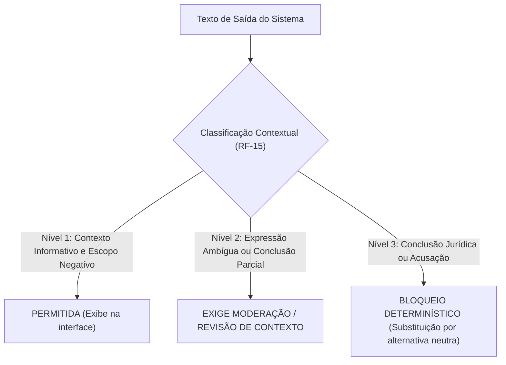

# Fronteira jurídica e diretrizes de comunicação

- **Projeto:** Fatura Aberta — Grupo 8 (Challenge 2)
- **Responsável:** Frente F1 — Produto, Pesquisa e Conformidade (Natália Evelin Maria dos Santos)
- **Par de revisão:** Talita
- **Data de recebimento do relatório:** 18/11/2026
- **Data do registro:** 25/11/2026
- **Situação:** Parecer informal registrado e diretrizes de comunicação avaliadas (aguardando revisão por pares)

---

## 1. Identificação da consulta e contexto documental

Em atendimento ao planejamento da Frente F1 (atividade S1-04, issue `#4`), registra-se a consulta informal por escrito realizada com a docente de Direito **Sarah Gleyce**, cujo recebimento do relatório técnico-regulatório conclusivo de 35 páginas ([`docs/assets/analise-juridico-regulatoria-fatura-aberta.pdf`](../assets/analise-juridico-regulatoria-fatura-aberta.pdf)) em **18/11/2026** é confirmado pela representante da equipe na consulta, **Natália Evelin Maria dos Santos** (Líder da Frente F1 — Produto, Pesquisa e Conformidade).

- **Docente consultada:** Sarah Gleyce (docente de Direito).
- **Representante da equipe:** Natália Evelin Maria dos Santos (F1).
- **Data de recebimento do relatório:** 18/11/2026.
- **Modalidade:** Consulta informal por escrito, realizada a partir de questionário estruturado em 14 tópicos sobre conformidade e limites de atuação, com devolutiva consubstanciada no relatório técnico-regulatório de 35 páginas.
- **Nota documental sobre autoria:** O arquivo PDF original de 35 páginas não apresenta identificação nominal ou assinatura de Sarah Gleyce, contendo perguntas formuladas à interlocutora ("a senhora") e as respectivas análises e respostas técnicas. A vinculação da consulta informal e do relatório à docente é registrada neste documento mediante confirmação direta da responsável da F1.
- **Objetivo da consulta:** Fixar a fronteira entre a disponibilização de informações técnico-regulatórias abertas e a atividade privativa de consultoria jurídica (Lei nº 8.906/1994, art. 1º, II), avaliar o catálogo de frases dos níveis A, B e C, orientar a calibração do verificador léxico `RF-15` e embasar as salvaguardas da ferramenta.

> [!NOTE] Natureza do Documento e Limitação Fundamental
> Conforme registrado expressamente nas páginas 1 e 3 do relatório técnico, esta publicação reúne uma **análise acadêmica e técnico-regulatória** elaborada para apoiar as decisões de produto, engenharia e governança do projeto Fatura Aberta. Diferencia conferência matemática, verificação técnica e avaliação jurídica individualizada, **não constituindo parecer jurídico formal nem manifestação oficial da ANEEL ou da Neoenergia Brasília**.

---

## 2. Fronteira entre conferência técnica e consultoria jurídica

O art. 1º, II, da Lei Federal nº 8.906/1994 (Estatuto da Advocacia e da OAB) estabelece que as atividades de consultoria, assessoria e direção jurídicas são privativas da advocacia. A análise constante das páginas 6 e 7 do relatório demonstra que a disponibilização de normas públicas e a conferência matemática não configuram automaticamente consultoria jurídica, desde que respeitados os seguintes limites:

```
+-----------------------------------------------------------------------------------+
|                           ZONA DE SEGURANÇA INFORMATIVA                           |
|  - Realizar operações matemáticas com os dados impressos na fatura                |
|  - Comparar tarifas e bandeiras com resoluções públicas homologadas pela ANEEL    |
|  - Citar expressamente ato normativo, dispositivo legal e período de vigência      |
|  - Indicar ausência de dados ou abster-se quando a informação for incompleta      |
|  - Disponibilizar minuta neutra de pedido de esclarecimentos e canais públicos    |
+-----------------------------------------------------------------------------------+
                                         │
                                         ▼ (LIMIAR DE RISCO JURÍDICO)
+-----------------------------------------------------------------------------------+
|                           ZONA VEDADA (CONSULTORIA PRIVATIVA)                     |
|  ✗ Afirmar categoricamente que uma cobrança é "ilegal", "abusiva" ou "fraudulenta"|
|  ✗ Declarar a existência de direito subjetivo à restituição ou repetição de indébito |
|  ✗ Calcular estimativas de devolução financeira ou quantificar danos morais/materiais|
|  ✗ Indicar estratégia processual, sugerir ajuizamento de ação ou orientar não pagar |
|  ✗ Assinar, protocolar ou peticionar em nome do consumidor                        |
+-----------------------------------------------------------------------------------+
```

### Cinco Diretrizes Centrais do Relatório (Págs. 3–4)

1. **Separar fato, cálculo e interpretação:** O sistema deve explicitar o dado extraído, a operação realizada, a regra ou fonte regulatória aplicada e a limitação da conclusão.
2. **Não transformar divergência em acusação:** Descrever as diferenças identificadas de maneira estritamente objetiva, sem atribuir causa, culpa ou responsabilidade à concessionária.
3. **Adotar abstenção explícita:** Quando faltarem dados, o sistema deve informar o que não conseguiu verificar, em vez de classificar silenciosamente o item como correto.
4. **Tratar dados pessoais desde a concepção (*Privacy by Design*):** Processamento com minimização, segurança, transparência e regras claras de retenção e descarte.
5. **Manter cálculos e regras críticas determinísticos:** A inteligência artificial pode auxiliar na extração e na explicação didática, mas não deve criar tarifas, dispositivos normativos ou conclusões jurídicas.

---

## 3. Avaliação e validação das frases que o produto pretende utilizar

As frases propostas pela equipe técnica foram avaliadas individualmente nas páginas 17 a 21 do relatório técnico, considerando clareza, precisão e risco de interpretação pelo consumidor:

### 3.1. Nível A — Conferências aritméticas

| Item | Frase original proposta | Avaliação no relatório | Redação recomendada e validada | Rastreabilidade |
|---|---|---|---|---|
| **A1** | *"A soma aritmética dos itens listados na fatura difere do total geral impresso."* | **Adequada com ressalvas** | *"A soma dos itens identificados nesta fatura difere do total geral impresso. Confira os componentes considerados nesta comparação."* | Relatório, pág. 17 |
| **A2** | *"O consumo faturado não corresponde à diferença entre leitura atual e leitura anterior."* | **Reformular** (a comparação simples pode sugerir erro de faturamento sem considerar multiplicador do medidor, leitura estimada ou troca de medidor) | *"Os valores de leitura apresentados não correspondem diretamente ao consumo faturado nesta conferência. A diferença pode depender de critérios de medição ou faturamento não identificados no documento."* | Relatório, pág. 17 |
| **A3** | *"O produto entre consumo faturado (X kWh) e tarifa impressa (R$ Y/kWh) resulta em R$ Z, divergindo do valor cobrado na linha (R$ W)."* | **Reformular** (o cálculo multiplicação pode não contemplar componentes adicionais como TE, TUSD, tributos, bandeiras ou encargos) | *"Considerando exclusivamente o consumo faturado e a tarifa unitária informados nesta linha, o resultado matemático é R$ Z. Esse valor difere do total apresentado na linha, cuja composição pode envolver outros componentes."* | Relatório, pág. 18 |
| **A4** | *"Foi identificada uma possível divergência nos valores apresentados."* | **Adequada com ressalvas** (prudente, mas genérica; o usuário precisa saber qual informação divergiu) | *"Foi identificada uma diferença entre [informação A] e [informação B], considerando os dados extraídos da fatura."* | Relatório, pág. 18 |

### 3.2. Nível B — Comparação com tabelas oficiais da ANEEL

| Item | Frase original proposta | Avaliação no relatório | Redação recomendada e validada | Rastreabilidade |
|---|---|---|---|---|
| **B1** | *"A tarifa unitária impressa diverge da tabela oficial da ANEEL vigente na data de referência que conseguimos obter..."* | **Reformular** (eliminar a expressão *"que conseguimos obter"*, que transmite incerteza desnecessária) | *"A tarifa unitária identificada na fatura difere do valor constante na tabela tarifária oficial consultada para a classe e o período de referência indicados. Consulte a fonte, o ato e a vigência utilizados nesta comparação."* | Relatório, pág. 18 |
| **B2** | *"O valor adicional de bandeira tarifária difere do patamar publicado pela ANEEL para o mês de referência."* | **Reformular** (a cobrança deve ser confrontada com o período efetivo de consumo, considerando rateio proporcional quando o ciclo transpassa dois meses) | *"O adicional de bandeira tarifária identificado na fatura apresenta diferença em relação ao parâmetro publicado para o período considerado nesta conferência."* | Relatório, pág. 19 |
| **B3** | *"Não foi possível confrontar este item com a tabela oficial vigente."* | **Reformular** (deve deixar explícito que a falta de comparação não representa validação do valor) | *"Este item não pôde ser comparado com uma tabela oficial aplicável ao período analisado. Portanto, não foi possível confirmar sua compatibilidade nem identificar divergência."* | Relatório, pág. 19 |

### 3.3. Nível C — Situações que exigem esclarecimentos

| Item | Frase original proposta | Avaliação no relatório | Redação recomendada e validada | Rastreabilidade |
|---|---|---|---|---|
| **C1** | *"Há indício que não pode ser confirmado apenas com os dados impressos na fatura; recomenda-se solicitar memória de cálculo..."* | **Reformular** (a palavra *"indício"* sugere suspeita de irregularidade e *"recomenda-se"* pode soar como aconselhamento individualizado) | *"Os dados disponíveis não permitem esclarecer a origem desta diferença. A memória de cálculo da distribuidora pode fornecer informações adicionais sobre os critérios utilizados."* | Relatório, pág. 19 |
| **C2** | *"Não foram encontradas evidências suficientes para concluir a análise."* | **Reformular** (incompleta; pode ser interpretada como ausência de divergência ou aprovação tácita) | *"Não foi possível concluir a conferência deste item com os dados disponíveis. Isso não significa que o valor tenha sido validado."* | Relatório, pág. 20 |
| **C3** | *"Recomendamos solicitar esclarecimentos à distribuidora."* | **Reformular** (o encaminhamento deve ser apresentado como informação de procedimento disponível, sem imperativos) | *"Caso deseje compreender melhor a composição deste valor, os canais de atendimento da distribuidora podem fornecer esclarecimentos e informações complementares."* | Relatório, pág. 20 |
| **C4** | *"Em caso de dúvida sobre seus direitos, procure o Procon-DF ou a Defensoria Pública do DF."* | **Adequada com ressalvas** (indicação legítima de órgãos públicos; deve manter tom puramente informativo) | *"Para obter informações sobre direitos do consumidor e conhecer os serviços de atendimento disponíveis, consulte o Procon-DF ou a Defensoria Pública do Distrito Federal."* | Relatório, pág. 20 |

### 3.4. Aviso geral de transparência (G1)

| Item | Frase original proposta | Avaliação no relatório | Redação recomendada e validada | Rastreabilidade |
|---|---|---|---|---|
| **G1** | *"Esta análise é informativa e não substitui uma avaliação técnica ou jurídica especializada."* | **Adequada com complementação** (adequada, mas deve explicar o escopo da conferência e a ausência de garantia integral) | *"Esta ferramenta realiza conferências informativas com base nos dados identificados na fatura e nas fontes regulatórias indicadas. Os resultados estão limitados às verificações efetivamente realizadas e não representam garantia de correção integral da cobrança, conclusão sobre sua legalidade ou reconhecimento de direitos individuais. A análise não substitui avaliação técnica ou jurídica especializada."* | Relatório, pág. 21 |

### 3.5. Frases que o produto pretende evitar (X1 a X4)

| Código | Frase original | Avaliação no relatório | Risco identificado e alternativa recomendada | Rastreabilidade |
|---|---|---|---|---|
| **X1** | *"Sua conta está errada."* | **Evitar** | Apresenta conclusão absoluta; uma divergência isolada não comprova erro na conta inteira.<br>➔ **Alternativa:** *"Foi identificada uma diferença em um dos itens conferidos."* | Relatório, pág. 21 |
| **X2** | *"A distribuidora realizou uma cobrança ilegal."* | **Evitar** | Atribui violação jurídica à concessionária sem análise processual individualizada.<br>➔ **Alternativa:** *"Os dados analisados apresentam uma diferença que não pôde ser esclarecida com as informações disponíveis."* | Relatório, pág. 21 |
| **X3** | *"Você tem direito à devolução do valor."* | **Evitar** | Reconhece um direito financeiro sem apuração dos fatos e dos requisitos legais aplicáveis.<br>➔ **Alternativa:** *"A análise não determina a existência de valores a restituir. Eventuais consequências dependem da apuração dos fatos e das regras aplicáveis."* | Relatório, pág. 21 |
| **X4** | *"A empresa está cometendo uma fraude."* | **Evitar** | Imputação de conduta criminosa sem base probatória, gerando risco severo de dano moral e ilícito civil.<br>➔ **Alternativa:** *"O documento apresenta uma informação que precisa ser esclarecida pela distribuidora."* | Relatório, pág. 21 |

---

## 4. Classificação contextual do verificador RF-15

A análise técnico-regulatória (páginas 22 e 23 do relatório) avaliou o bloqueio automático de expressões e concluiu que o **bloqueio automático por palavra isolada não é integralmente adequado**, pois impediria o sistema de apresentar delimitações legítimas de escopo negativo (por exemplo: *"Esta ferramenta não calcula restituição nem determina a existência de indenização"* seria indevidamente barrada).

Para solucionar essa limitação, o relatório recomenda adotar uma **classificação contextual em três níveis**:



### Nível 1 — Expressões permitidas em contexto informativo
Podem ser utilizadas para explicar conceitos gerais, limites operacionais e fontes normativas:
- *"A ferramenta não calcula indenização."*
- *"A análise não determina se houve fraude."*
- *"A legislação prevê hipóteses específicas de restituição."*

### Nível 2 — Expressões que exigem revisão e moderação
Devem ser avaliadas antes da exibição quando associadas a um caso concreto:
- Em vez de *"Possível cobrança indevida"* ➔ Utilizar: **"Diferença identificada entre o valor calculado e o valor faturado."**
- Em vez de *"Indício de irregularidade"* ➔ Utilizar: **"Os dados disponíveis não permitem confirmar a correspondência das grandezas."**
- Em vez de *"Direito à restituição"* ➔ Utilizar: **"A análise não determina a existência de valores a restituir."**
- Em vez de *"Responsabilidade da distribuidora"* ➔ Utilizar: **"Consulte os canais de atendimento da concessionária para obter esclarecimentos sobre os critérios aplicados."**

### Nível 3 — Expressões estritamente proibidas como conclusão automática (`RF-15`)
Não devem ser geradas pelo sistema como afirmações sobre a situação individual do consumidor:
1. **Qualificação jurídica conclusiva e acusatória:** `ilegal`, `ilegalidade`, `ilícito`, `crime`, `criminoso`, `criminosa`, `fraude`, `roubo`, `extorsão`, `golpe`, `estelionato`, `cobrança abusiva`, `má-fé`.
2. **Reparação financeira ou promessa indenizatória:** `restituição`, `ressarcimento`, `repetição de indébito`, `danos morais`, `dano material`, `indenização`, `devolução em dobro`, `obrigação de indenizar`, `enriquecimento ilícito`.
3. **Aconselhamento processual privativo:** `ação judicial`, `juizado especial`, `petição inicial`, `causa ganha`, `processar`, `não pague a fatura`, `débito inexistente`.

> **Termos adicionais a monitorar contextualmente (Pág. 23):** `abuso`, `ilícito contratual`, `descumprimento legal`, `direito adquirido`, `valor devido`, `cobrança fraudulenta`.

---

## 5. Recomendações do relatório, decisões de produto e implementação técnica

Para assegurar governança estrita e rastreabilidade, diferenciam-se a seguir as recomendações do relatório técnico, as decisões tomadas pela Frente de Produto (F1) e as funcionalidades efetivamente construídas no repositório:

### 5.1. Recomendações jurídico-regulatórias do relatório técnico (Págs. 10 a 32)
- **Avisos em múltiplos momentos (Pág. 10):** A transparência deve aparecer: (1) antes do envio da fatura; (2) na tela de resultados; (3) na geração da minuta; e (4) na política de privacidade.
- **Minuta de Nível C estritamente administrativa (Págs. 12–13):** Estruturada como solicitação de informações e memória de cálculo (REN nº 1.000/2021), sem formular tese jurídica, sem prometer reparação e sem assinar pelo titular.
- **Governança tarifária rigorosa (Págs. 25–26):** Rastrear classe B1, separar TE e TUSD, calcular bandeiras por ciclo proporcional e consignar a natureza provisória do resultado da revisão tarifária de 2026 da Neoenergia Brasília.
- **Abstenção como funcionalidade de segurança (Pág. 32):** Implementar categoria própria de abstenção em vez de classificar silenciosamente a fatura como correta quando faltarem dados.

### 5.2. Decisões de produto e recomendações em avaliação (F1)
- **Decisões de produto já aprovadas pela equipe:**
  - *Foco no Grupo B1 residencial:* O escopo do produto restringe-se exclusivamente a faturas residenciais urbanas da Neoenergia Brasília no Distrito Federal, excluindo Grupo A e micro/minigeração distribuída.
  - *Recusa de peticionamento automatizado:* O sistema não protocola nem envia requerimentos em nome do consumidor, assegurando que o titular revise a minuta e decida autonomamente se deseja acionar a distribuidora.
- **Recomendações sujeitas à aprovação e priorização da equipe:**
  - *Adoção formal de cinco categorias de achados (Pág. 31):* Classificação dos resultados em *Compatível*, *Divergência identificada*, *Verificação necessária*, *Dados insuficientes (abstenção)* e *Fora do escopo*.
  - *Integração dos avisos contextuais e minuta editável:* Inclusão dos avisos nos três momentos e disponibilização da minuta como modelo de apoio na interface.

### 5.3. Controles identificados no código-fonte e salvaguardas em execução
- **Motor determinístico (`packages/motor`):** Checagens aritméticas (Nível A) e tarifárias (Nível B) implementadas por meio de algoritmos determinísticos em Python, sem intervenção probabilística de modelos de linguagem para o cálculo.
- **Extração e contratos (`packages/extracao` e `packages/contratos`):** O contrato estruturado `Fatura` não possui campos destinados a dados pessoais identificáveis (nome, endereço, CPF), e o módulo conta com a função `anonimizar()` para remoção ou mascaramento de identificadores em textos processados. A garantia de que nenhum dado pessoal conste em registros auxiliares em produção requer auditoria no ambiente de execução.
- **Provedores de modelo (`packages/agentes`):** O código implementa clientes para execução local com Ollama e cliente simulado de teste, sem conectores configurados para provedores externos de IA. A inexistência de conexões externas no ambiente de produção depende da configuração de infraestrutura e rede.
- **API (`apps/api`):** O endpoint `POST /analisar` define `Cache-Control: no-store` e métricas operacionais restritas à memória volátil. O caráter estritamente efêmero do processamento em runtime depende da validação do ciclo de vida de arquivos temporários e do descarte de buffers de aplicação.

---

## 6. Ressalvas documentais do relatório (Página 35)

Para assegurar a integridade da comunicação técnica e evitar que o relatório seja interpretado como uma investigação exaustiva concluída sobre a distribuidora, incorporam-se integralmente as ressalvas da página 35 do estudo técnico:

1. **Cadeia de prestadores e terceirização:** Não foram apresentados contratos atuais de todos os fornecedores da Neoenergia Brasília. Portanto, não é possível identificar de forma conclusiva toda a cadeia de terceirização operacional ou de TI.
2. **Conferência direta das tarifas homologadas:** Os anexos tarifários completos da REH nº 3.614/2026 devem ser conferidos diretamente na ANEEL antes da inserção definitiva de valores específicos de TE e TUSD em código.
3. **Natureza provisória da revisão tarifária de 2026:** A decisão tarifária aprovada pela ANEEL em outubro de 2026 foi divulgada como provisória. A fixação definitiva permanece sujeita à fiscalização das inconsistências identificadas nos dados de mercado da distribuidora decorrentes da implantação do novo sistema comercial.
4. **Ausência de generalização sobre o sistema comercial:** Não foi demonstrado que uma fatura específica analisada tenha sido necessariamente afetada por inconsistências da migração do sistema comercial da empresa.
5. **Apuração concreta de responsabilidade:** A responsabilidade de cada agente envolvido na prestação do serviço deve ser avaliada caso a caso, conforme sua atuação concreta, conduta, dano e nexo causal.
6. **Revisão normativa permanente:** A análise não substitui a revisão dos dispositivos consolidados vigentes da REN nº 1.000/2021 antes da transformação de referências normativas em regras automatizadas. As recomendações devem ser validadas pela equipe responsável e atualizadas sempre que houver alteração regulatória, tarifária ou operacional.

---

## 7. Encaminhamentos decorrentes da consulta

A Frente F1 adota as seguintes providências para cumprimento da issue `#4`:

1. **Submissão à governança do projeto:** As diretrizes de comunicação, os limites da fronteira jurídica e o vocabulário avaliado são submetidos à revisão por pares e à apreciação da equipe técnica para orientar a evolução do produto.
2. **Atualização dos testes automatizados:** O catálogo de expressões e as regras de bloqueio do `RF-15` orientam a revisão contínua dos testes de conformidade textual em `packages/agentes/tests/`.
3. **Submissão à revisão por pares:** O documento é submetido à revisão da par da F1, **Talita** (`@TalitaaNunes`), na branch `docs/4-fronteira-juridica`, para deliberação antes do merge na branch `dev`.
