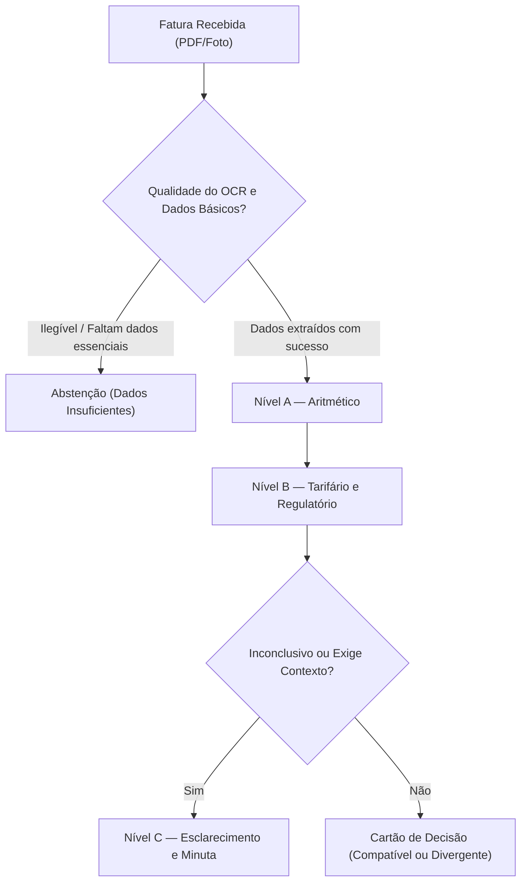

# Recomendações Jurídico-Regulatórias para o Produto

> [!NOTE] Natureza do Documento
> Este documento consolida a análise acadêmica e técnico-regulatória desenvolvida no âmbito da Frente F1 (Produto, Pesquisa e Conformidade) do projeto **Fatura Aberta** (Grupo 8 — Residência em IA UnB/Instituto Eldorado, Novembro de 2026). O estudo baseia-se no relatório técnico de 35 páginas [`analise-juridico-regulatoria-fatura-aberta.pdf`](../assets/analise-juridico-regulatoria-fatura-aberta.pdf).
>
> **Ressalva Fundamental:** Esta análise tem natureza estritamente acadêmica, técnica e informativa. Não constitui parecer jurídico formal, não substitui consulta profissional individualizada e não representa manifestação oficial da ANEEL, da Neoenergia Brasília, do Procon-DF, da Defensoria Pública ou de qualquer órgão regulador.

---

## 1. Objetivo e Escopo da Análise

O objetivo deste estudo é estabelecer balizas claras de produto, engenharia e governança para assegurar que o **Fatura Aberta** atue como um verificador aberto, auditável e informativo de faturas de energia elétrica, sem incorrer no exercício ilegal da consultoria jurídica (Lei nº 8.906/1994, art. 1º, II) nem gerar falsas expectativas ou desinformação para o consumidor residencial.

### 1.1. Delimitação de Escopo no MVP
* **Público-alvo:** Consumidores residenciais do **Grupo B1** atendidos pela distribuidora **Neoenergia Distribuição Brasília S.A.** no Distrito Federal.
* **Modalidade de entrada:** Leitura de faturas em arquivo digital (PDF nativo) ou fotografia/imagem digitalizada da fatura impressa.
* **Metodologia de análise:** Extração de campos estruturados, conferência matemática determinística, cotejo com parâmetros oficiais homologados pela ANEEL e busca contextual em corpus normativo filtrado por vigência.
* **Fronteira negativa de escopo:** O produto **não atende** unidades de média/alta tensão (Grupo A), micro ou minigeração distribuída (Sistema de Compensação de Energia Elétrica — SCEE), faturas de saneamento/água (Caesb) ou telecomunicações.

---

## 2. Fronteira entre Informação e Consultoria Jurídica

A legislação brasileira reserva privativamente à advocacia as atividades de consultoria, assessoria e direção jurídicas (Lei nº 8.906/1994, art. 1º, II; Regulamento Geral do Estatuto da Advocacia; e Recomendação CFOAB nº 001/2024 sobre IA).

A análise estabelece critérios rigorosos para diferenciar a **conferência técnica informacional** da **consultoria jurídica individualizada**:

```
+-----------------------------------------------------------------------------------+
|                           ZONA DE SEGURANÇA INFORMATIVA                           |
|  - Realizar operações matemáticas com os dados impressos na fatura                |
|  - Comparar tarifas e bandeiras com resoluções públicas homologadas pela ANEEL    |
|  - Citar expressamente ato normativo, dispositivo legal e período de vigência      |
|  - Indicar ausência de dados ou abster-se quando a informação for incompleta      |
|  - Disponibilizar minuta neutra de pedido de esclarecimentos e canais públicos    |
+-----------------------------------------------------------------------------------+
                                         │
                                         ▼ (LIMIAR DE RISCO JURÍDICO)
+-----------------------------------------------------------------------------------+
|                           ZONA VEDADA (CONSULTORIA PRIVATIVA)                     |
|  ✗ Afirmar categoricamente que uma cobrança é "ilegal", "abusiva" ou "fraudulenta"|
|  ✗ Declarar a existência de direito subjetivo à restituição ou repetição de indébito |
|  ✗ Calcular estimativas de devolução financeira ou quantificar danos morais/materiais|
|  ✗ Indicar estratégia processual, sugerir ajuizamento de ação ou orientar não pagar |
|  ✗ Assinar, protocolar ou peticionar em nome do consumidor                        |
+-----------------------------------------------------------------------------------+
```

### Cinco Diretrizes Centrais do Produto
1. **Separar fato, cálculo e interpretação:** Exibir com transparência o dado extraído, a fórmula aplicada, a fonte regulatória e o limite da verificação.
2. **Não transformar divergência em acusação:** Descrever a diferença matemática de forma neutra e objetiva, sem imputar dolo, culpa ou fraude à concessionária.
3. **Adotar abstenção explícita:** Quando faltarem elementos (ex.: histórico de medição ou tabela homologada aplicável), declarar impossibilidade de conclusão em vez de aprovar silenciosamente.
4. **Privacidade desde a concepção (*Privacy by Design*):** Processar faturas com minimização, descarte seguro de PII e segregação estrita de dados.
5. **Determinismo nas regras críticas:** O núcleo decisório aritmético e tarifário deve ser 100% determinístico; modelos de linguagem (IA) devem atuar estritamente na extração e na explicação didática.

---

## 3. Síntese das 14 Perguntas e Respostas da Análise

| Nº | Pergunta Central | Resposta Objetiva e Diretriz Técnica |
|---|---|---|
| **01** | **Fronteira entre informação e consultoria jurídica:** Onde passa a fronteira e quais fatores pesam no desenho? | A conferência matemática e o confronto com tabelas públicas são legítimos. O limite é ultrapassado se o sistema passar a qualificar ilicitude, reconhecer direitos individuais subjetivos ou prescrever estratégias litigiosas. |
| **02** | **Diferença entre expressões:** “Diverge do cálculo”, “indevida”, “irregular” e “inconsistente”? | **“Diverge do cálculo”** é a expressão mais segura e estritamente factual. **“Indevida”** e **“ilegal”** são qualificações jurídicas vedadas (`RF-15`). **“Irregular”** transmite ideia precipitada de infração normativa. **“Inconsistente”** é aceitável desde que acompanhada do apontamento concreto do dado conflitante. |
| **03** | **Construções a evitar:** Imperativos, “você tem direito” e afirmações categóricas? | Evitar afirmações peremptórias sobre direitos ou ordens de conduta (*“não pague a conta”*, *“processe a empresa”*). Adotar fórmulas em linguagem de evidência: *“A análise identificou…”*, *“Com os dados disponíveis, foi possível verificar…”*, *“Os canais oficiais podem fornecer informações adicionais”*. |
| **04** | **Responsabilidade por divergências equivocadas:** O caráter acadêmico e código aberto afasta riscos? | **Não.** O caráter acadêmico/aberto favorece a transparência, mas não confere imunidade jurídica nem afasta a incidência do CDC (art. 14) ou da LGPD em caso de danos ao usuário. Medidas preventivas: exibir campos para conferência do usuário, indicar confiança do OCR, versionar fontes e dispor de canal de reporte de erros. |
| **05** | **Avisos de limitação da ferramenta:** Quais avisos são necessários e onde exibi-los? | A transparência deve ser contextual e distribuída em **três momentos**: (1) antes do upload da fatura; (2) em cada resultado/achado do cartão de decisão; e (3) no cabeçalho da minuta de esclarecimento. Um aviso genérico no rodapé é insuficiente. |
| **06** | **Citação de normas e tabelas ANEEL:** Como comunicar incertezas sobre atualização de fontes? | Toda norma ou tarifa deve ser identificada, versionada e vinculada ao período exato de consumo da fatura. A expressão coloquial *“que conseguimos obter”* deve ser eliminada do produto final. Se a vigência não puder ser confirmada, o sistema deve abster-se. |
| **07** | **Insuficiência de evidências e abstenção:** Como comunicar a falta de dados sem sugerir aprovação tácita? | Combinar **abstenção expressa**, indicação do dado faltante e explicação clara do motivo. A ausência de divergência detectada **nunca** deve ser comunicada como garantia de que a fatura está correta. |
| **08** | **Minuta de pedido de esclarecimentos:** Como manter seu caráter estritamente informativo? | Estruturar a minuta como requerimento administrativo simples de informações e memória de cálculo. Não usar estrutura de petição judicial, não invocar dano moral nem assinar em nome do titular. O consumidor decide livremente se edita e encaminha o texto. |
| **09** | **Tratamento de dados pessoais (LGPD):** Quais cuidados no MVP e na fase de pesquisa? | Faturas residenciais contêm dados pessoais identificáveis (nome, endereço, CPF, código de instalação). O produto atua como controlador independente ao definir as finalidades da análise. Cuidados: mascaramento de identificadores dispensáveis, descarte do documento após a análise, criptografia e proibição de usar faturas reais para treino de modelos sem base legal específica. |
| **10** | **Encaminhamento a Procon-DF e Defensoria Pública:** Como orientar sem prescrever estratégia? | Apresentar os órgãos públicos exclusivamente como canais de informação e atendimento ao cidadão, disponibilizando links e endereços oficiais, sem prometer desfechos favoráveis (*“o Procon vai obrigar a devolução”*). |
| **11** | **Redação do Aviso de Transparência:** Qual a fórmula recomendada? | Adotar texto explícito indicando que a ferramenta realiza conferências informativas limitadas às checagens executadas, sem garantia de validação integral nem efeito vinculante, não substituindo avaliação jurídica ou técnica especializada. |
| **12** | **Citação de artigos e vigência:** Pode ser confundida com parecer jurídico? | A citação isolada de norma pública e vigência é atividade informativa legítima. O risco surge se o sistema vincular a citação a um juízo automático de culpa ou reparação financeira. Deve ser acompanhada de ressalva informativa. |
| **13** | **Edição da minuta pelo consumidor:** A possibilidade de alteração protege a ferramenta? | A liberdade de edição reforça o papel de apoio informativo da ferramenta, mas não exime o sistema de responsabilidade se o modelo padrão já gerar acusações levianas ou promessas indenizatórias. Campos de contexto devem ser editáveis; avisos informativos devem ser fixos. |
| **14** | **Recomendações complementares:** Quais pontos essenciais não haviam sido cobertos? | Governança estrita das fontes tarifárias; distinção entre tarifa provisória e definitiva da Neoenergia Brasília (2026); diferenciação entre confiança da extração (OCR) e confiança da regra; criação de categoria própria de abstenção; e testes com cenários de faturamento atípico (ciclos irregulares, medição estimada e mudança de medidor). |

---

## 4. Regras de Comunicação e Expressões Controladas

Para operacionalizar a fronteira jurídica (`RF-15`), o sistema deve substituir o bloqueio cego de palavras isoladas por uma **classificação contextual em três níveis**:

### Nível 1 — Expressões Permitidas em Contexto Informativo
Podem ser empregadas para delimitar o escopo da ferramenta, explicar conceitos regulatórios gerais e indicar fontes normativas:
* *“A ferramenta não calcula indenização nem valores de restituição.”*
* *“A análise não determina se houve fraude ou erro intencional.”*
* *“A regulamentação setorial prevê hipóteses específicas para apuração de diferenças de faturamento.”*

### Nível 2 — Expressões que Exigem Contexto e Moderação
Expressões técnicas que não devem ser emitidas como conclusão categórica de um caso individual:
* Em vez de *“Possível cobrança indevida”* ➔ Utilizar: **“Diferença identificada entre o valor calculado e o valor faturado.”**
* Em vez de *“Indício de irregularidade”* ➔ Utilizar: **“Os dados disponíveis não permitem confirmar a correspondência das grandezas.”**
* Em vez de *“Responsabilidade da distribuidora”* ➔ Utilizar: **“Consulte os canais de atendimento da concessionária para obter esclarecimentos sobre os critérios aplicados.”**

### Nível 3 — Expressões Estritamente Vedadas como Conclusão (`RF-15`)
Termos cujo emprego em conclusões automatizadas gera risco direto de infração ética ou civil:
* **Qualificação jurídica acusatória:** *“ilegal”*, *“ilegalidade”*, *“ilícito”*, *“crime”*, *“criminoso”*, *“fraude”*, *“roubo”*, *“extorsão”*, *“golpe”*, *“estelionato”*, *“cobrança abusiva”*, *“má-fé”*.
* **Reparação financeira ou promessa indenizatória:** *“restituição”*, *“ressarcimento”*, *“repetição de indébito”*, *“danos morais”*, *“dano material”*, *“indenização”*, *“devolução em dobro”*, *“obrigação de indenizar”*, *“enriquecimento ilícito”*.
* **Aconselhamento processual/litigioso:** *“ação judicial”*, *“juizado especial”*, *“petição inicial”*, *“causa ganha”*, *“processar”*, *“não pague a fatura”*, *“débito inexistente”*.

### 4.1. Termos Adicionais sob Monitoramento Contextual (Seção 6.3 do Relatório)
Recomenda-se monitorar e avaliar a ocorrência dos seguintes termos antes da exibição:
`abuso`, `má-fé`, `ilícito contratual`, `dano moral`, `dano material`, `enriquecimento ilícito`, `cobrança abusiva`, `descumprimento legal`, `obrigação de indenizar`, `direito adquirido`, `valor devido`, `débito inexistente`, `cobrança fraudulenta`.

---

## 5. Classificação dos Resultados nos Três Níveis de Evidência

A arquitetura de resposta do Fatura Aberta distribui suas checagens em três níveis complementares, com redações padronizadas e verificáveis:



### 5.1. Nível A — Conferências Aritméticas (Dados da Própria Fatura)
* **A1 (Soma de Itens):** *“A soma dos itens identificados nesta fatura difere do total geral impresso. Confira os componentes considerados nesta comparação.”*
* **A2 (Leituras vs. Consumo):** *“Os valores de leitura apresentados não correspondem diretamente ao consumo faturado nesta conferência. A diferença pode depender de critérios de medição, constante de medidor ou faturamento acumulado não identificados no documento.”*
* **A3 (Multiplicação Quantidade × Tarifa):** *“Considerando exclusivamente o consumo faturado e a tarifa unitária informados nesta linha, o resultado matemático é R$ Z. Esse valor difere do total apresentado na linha, cuja composição pode envolver outros encargos ou tributos.”*
* **A4 (Indicação Geral):** *“Foi identificada uma diferença entre [informação A] e [informação B], considerando os dados extraídos da fatura.”*

### 5.2. Nível B — Confronto com Parâmetros Oficiais Homologados (ANEEL)
* **B1 (Tarifa Unitária Homologada):** *“A tarifa unitária identificada na fatura difere do valor constante na tabela tarifária oficial consultada para a classe e o período de referência indicados. Consulte a fonte, o ato normativo e a vigência considerados nesta conferência.”*
* **B2 (Adicional de Bandeira Tarifária):** *“O adicional de bandeira tarifária identificado na fatura apresenta diferença em relação ao parâmetro publicado para o período considerado nesta conferência.”* (Atenção ao rateio proporcional de ciclos que transpassam dois meses).
* **B3 (Impossibilidade de Confronto Oficial):** *“Este item não pôde ser comparado com uma tabela oficial aplicável ao período analisado. Portanto, não foi possível confirmar sua compatibilidade nem identificar divergência.”*

### 5.3. Nível C — Situações que Exigem Esclarecimentos e Informação Complementar
* **C1 (Esclarecimento de Composição):** *“Os dados disponíveis não permitem esclarecer a origem desta diferença. A memória de cálculo da distribuidora pode fornecer informações adicionais sobre os critérios utilizados.”*
* **C2 (Abstenção Formal):** *“Não foi possível concluir a conferência deste item com os dados disponíveis. Isso não significa que o valor tenha sido validado.”*
* **C3 (Canais de Atendimento):** *“Caso deseje compreender melhor a composição deste valor, os canais de atendimento da distribuidora podem fornecer esclarecimentos e informações complementares.”*
* **C4 (Canais Públicos de Defesa do Consumidor):** *“Para obter informações sobre direitos do consumidor e conhecer os serviços de atendimento disponíveis, consulte o Procon-DF ou a Defensoria Pública do Distrito Federal.”*

### 5.4. Avisos Contextuais de Transparência
* **Aviso Inicial (Antes do Upload):**  
  *“O Fatura Aberta realiza conferências informativas de faturas residenciais B1 da Neoenergia Brasília, com base nos dados extraídos do documento e nas fontes regulatórias disponíveis. A análise não substitui a verificação da distribuidora nem uma avaliação técnica ou jurídica individualizada.”*
* **Aviso por Resultado (No Cartão de Decisão):**  
  *“Esta conferência considera apenas os dados e as fontes indicados. A ausência de divergência identificada não significa que todos os componentes da fatura foram validados.”*
* **Aviso na Minuta de Esclarecimento:**  
  *“Este texto foi gerado como apoio informativo. Revise os dados, complemente as informações necessárias e decida livremente se deseja encaminhá-lo à distribuidora.”*

---

## 6. Categorias Finais de Classificação dos Resultados

Para conferir auditabilidade a cada item do cartão de decisão, o sistema deve classificá-lo em uma de **cinco categorias formais**:

1. **Compatível (Verificação realizada):** As checagens aplicáveis foram executadas com dados suficientes e não indicaram divergência. *(Ressalva: não constitui chancela integral de regularidade da fatura).*
2. **Divergência identificada (Diferença encontrada):** Foi apurada incompatibilidade matemática ou documental objetiva entre grandezas confrontadas.
3. **Verificação necessária (Depende de dados adicionais):** Foi detectada discrepância ou atipicidade que depende de elementos externos à fatura (ex.: histórico de medição ou laudo de aferição).
4. **Dados insuficientes (Abstenção técnica):** A imagem possui baixa resolução, OCR ilegível ou faltam campos indispensáveis para a fórmula.
5. **Fora do escopo (Não aplicável):** A fatura não pertence à classe B1 residencial, refere-se a outra concessionária ou envolve GD/Grupo A.

> [!IMPORTANT] Princípio de Engenharia da Abstenção
> A **abstenção explícita** deve ser projetada como uma **funcionalidade central de segurança e confiabilidade do produto**, e não como um erro ou falha de sistema. Itens não analisados jamais devem ser contabilizados como aprovados.

---

## 7. Diretrizes Práticas de Proteção de Dados (LGPD)

A fatura de energia elétrica residencial reúne dados pessoais protegidos pela Lei Geral de Proteção de Dados (Lei nº 13.709/2018): titular, CPF, endereço completo, código da unidade consumidora, código de barras, linha digitável, QR Code PIX e histórico de consumo.

### 7.1. Papéis dos Agentes de Tratamento
* O **Fatura Aberta** atua como **controlador independente** em relação às faturas que recebe diretamente dos usuários, visto que define as finalidades e os meios essenciais do serviço de conferência.
* Fornecedores terceiros de infraestrutura, OCR ou APIs de modelos generativos atuam como **operadores** (ou suboperadores), devendo ser formalmente inventariados e avaliados quanto às garantias de segurança.

### 7.2. Regras Operacionais para o MVP
1. **Minimização de Dados:** O sistema deve extrair apenas as grandezas indispensáveis aos cálculos (consumo em kWh, valores monetários, datas de leitura/vencimento e bandeira). Dados de contato, CPF e identificadores bancários devem ser descartados ou mascarados na etapa de ingestão.
2. **Política de Armazenamento e Descarte:** Como padrão de arquitetura do MVP, adotar **processamento temporário em memória (efêmero)** com descarte imediato do arquivo original e dos artefatos intermediários de imagem após a emissão do cartão de decisão.
3. **Uso de IA e Modelos Externos:** É vedado o envio de faturas reais com dados pessoais desprotegidos para APIs de treinamento de modelos de terceiros. Modelos de VLM/OCR locais ou instâncias isoladas com garantia de não retenção devem ser priorizados.
4. **Criptografia e Registros:** Tráfego obrigatoriamente protegido por TLS 1.3 (em trânsito) e armazenamento volátil criptografado. Manutenção de logs de auditoria sem registro de PII.
5. **Tratamento de Incidentes de Segurança:** Observância dos prazos e procedimentos da Resolução CD/ANPD nº 15/2024 caso ocorra vazamento ou acesso não autorizado com risco relevante aos titulares.

---

## 8. Contexto Regulatório Específico: Neoenergia Brasília (2026)

A conferência de faturas no Distrito Federal durante o ano de 2026 exige controles especiais decorrentes de dois eventos fáticos e regulatórios destacados no relatório:

### 8.1. Revisão Tarifária Periódica (RTP) de 2026
* **Ato Homologatório:** Aprovado pela Diretoria Colegiada da ANEEL em 20/10/2026, com vigência das novas tarifas a partir de **22/10/2026** (Efeito Médio Geral: +1,92%; Consumidores Residenciais B1: **+1,11%**; Baixa Tensão: +1,06%; Alta Tensão: +4,27%).
* **Natureza Provisória da Decisão:** A ANEEL registrou expressamente que a homologação possui caráter **provisório**, ficando o resultado definitivo condicionado à conclusão de fiscalização específica sobre inconsistências na base de dados de mercado da distribuidora.
* **Impacto no Fatura Aberta:** Faturas com ciclo de leitura compreendido em outubro/novembro de 2026 podem conter consumo proporcional a duas tarifas distintas (pro rata die). O motor deve controlar a data de vigência e registrar no cartão que a tarifa de 2026 foi homologada com ressalva de fiscalização pela Agência.

### 8.2. Migração do Sistema Comercial da Distribuidora (Maio/2026)
* A distribuidora implantou novo sistema comercial em maio de 2026, gerando registros de instabilidade operacional, faturamentos acumulados, alteração de datas de leitura e emissão tardia de faturas.
* **Diretriz Técnica:** O Fatura Aberta **não deve atribuir genericamente divergências à migração do sistema** sem evidência específica. Faturas de períodos atípicos devem ser tratadas como cenários de teste para validação de regras de leitura estimada, faturamento plurissemestral e ajustes a crédito/débito.

---

## 9. Recomendações Técnicas Estruturadas de Engenharia

O relatório detalha modelos de dados e arquitetura essenciais para a confiabilidade e auditabilidade do produto:

### 9.1. Cadastro de Fontes Normativas (10 Campos de Metadados)
Toda fonte jurídica ou técnica deve ser catalogada com a seguinte estrutura:

| Campo | Finalidade Técnica |
|---|---|
| `orgao_emissor` | Identificar a autoridade competente (ex.: ANEEL, Câmara Legislativa do DF). |
| `ato_normativo` | Número e espécie do ato (ex.: REN nº 1.000/2021, REH nº 3.614/2026). |
| `dispositivo` | Artigo, parágrafo, inciso ou anexo específico. |
| `data_publicacao` | Data de publicação oficial para rastreabilidade cronológica. |
| `inicio_vigencia` | Marco temporal inicial de aplicabilidade cogente. |
| `fim_vigencia` | Controle de encerramento, revogação ou alteração superveniente. |
| `fonte_oficial` | URI/link verificável oficial (ex.: Imprensa Nacional ou Repositório ANEEL). |
| `data_consulta` | Registro temporal da captura e checagem do texto. |
| `versao` | Histórico de versão e indicação de texto consolidado. |
| `regra_vinculada` | Identificador da regra de negócio de software correspondente. |

### 9.2. Cadastro Tarifário Oficial (12 Campos de Parametrização)
Para viabilizar a comparação determinística do Nível B:

| Campo | Tratamento de Engenharia |
|---|---|
| `distribuidora` | Identificar `Neoenergia Distribuição Brasília S.A.`. |
| `classe` | Validar `Residencial`. |
| `subgrupo` | Conferir enquadramento `B1`. |
| `modalidade` | Identificar modalidade tarifária aplicável (ex.: Convencional). |
| `componente` | Separar estritamente Parcela TE e Parcela TUSD. |
| `bandeira` | Indicar adicional por patamar (Verde, Amarela, Vermelha 1, Vermelha 2, Escassez). |
| `vigencia_inicial` | Data de início de vigência da tabela tarifária. |
| `vigencia_final` | Data de término da vigência da tabela. |
| `ato_homologatorio` | Resolução Homologatória instituidora da ANEEL. |
| `fonte_oficial` | Link verificável da publicação oficial. |
| `situacao_regulatoria` | Registro de provisoriedade ou fiscalização em andamento. |
| `data_atualizacao` | Timestamp de atualização da base de dados do sistema. |

### 9.3. Separação de Responsabilidades em 6 Módulos Arquiteturais
A arquitetura do sistema deve isolar estritamente as atribuições operacionais:
1. **OCR e Extração:** Responsável por identificar os caracteres e dados brutos impressos na fatura.
2. **Validação:** Responsável por checar formato, completude, qualidade de imagem e coerência básica.
3. **Módulo Regulatório:** Responsável por fornecer normas consolidadas, parâmetros e tarifas versionadas.
4. **Motor de Cálculo:** Responsável exclusivo por operações aritméticas e comparações determinísticas.
5. **Módulo de Linguagem:** Responsável por formatar explicações em linguagem didática e acessível (`RNF-08`), sem criar fatos ou conclusões não chanceladas pelo motor.
6. **Módulo de Segurança:** Responsável pelo controle de acesso, criptografia, descarte seguro de PII e trilha de auditoria.

### 9.4. Schema do Registro Auditável de cada Achado (13 Campos)
Cada apontamento emitido pelo sistema deve conter a estrutura:
`identificador`, `dado_extraido`, `valor_identificado`, `origem_regiao`, `confianca_extracao`, `regra_aplicada`, `operacao_calculo`, `fonte_normativa`, `vigencia`, `data_consulta`, `resultado`, `limitacoes`, `explicacao`.

---

## 10. Matriz de Riscos Operacionais e Medidas de Mitigação

| Origem do Risco | Consequência Potencial | Medida Preventiva de Engenharia |
|---|---|---|
| **Falha de OCR / Leitura** | Extração de valor incorreto gerando falso alarme. | Exibição de campos extraídos para confirmação ativa do usuário; cálculo de score de confiança por campo; bloqueio se a confiança for inferior ao limiar. |
| **Imagem Ilegível / Cortada** | Cálculo realizado com dados parciais. | Abstenção automática com instrução para reenvio de foto legível. |
| **Tabela Tarifária Desatualizada** | Apontamento de divergência com base em tarifa não vigente. | Versionamento estrito no repositório com SHA-256, ato oficial e controle de vigência inicial e final. |
| **Enquadramento Incorreto** | Aplicação de tarifa B1 residencial a consumidor de outra classe (ex.: B2 rural ou comercial). | Validação do campo classe/subgrupo na fatura antes da execução das regras. |
| **Falta de Histórico de Medição** | Diferença entre leituras aparentando erro, quando decorre de troca de medidor ou leitura estimada. | Classificar como *“Verificação necessária”*, indicando que o histórico é indispensável. |
| **Vazamento de Dados Pessoais** | Exposição de PII ou envio inadvertido a terceiros. | Pré-processamento local com remoção de metadados, mascaramento de campos e exclusão do documento pós-análise. |
| **Interpretação como Consultoria** | Usuário adotar postura litigiosa ou recusar pagamento de fatura regular. | Barreiras de linguagem (`RF-15`), avisos contextuais de transparência e foco em solicitação de esclarecimentos. |

---

## 11. Matriz de Prioridades de Implementação

| Prioridade | Medida Técnica Recomendada | Frente Responsável | Justificativa |
|---|---|---|---|
| **ALTA** | **Versionamento de tabelas tarifárias** | F3 / F2 | Evitar comparações com parâmetros desatualizados ou de classe incorreta. |
| **ALTA** | **Validação e confirmação de OCR** | F4 | Impedir que falhas de extração se propaguem como erros aritméticos da concessionária. |
| **ALTA** | **Implementação de abstenção formal** | F3 / F5 | Assegurar que o sistema não emita parecer sem evidência completa. |
| **ALTA** | **Política de privacidade e governança LGPD** | F1 / F6 | Garantir conformidade com a Lei nº 13.709/2018 e proteção do titular. |
| **ALTA** | **Revisão das mensagens e vocabulário contextual** | F1 / F6 | Bloquear afirmações jurídicas peremptórias (`RF-15`) na interface e no cartão. |
| **ALTA** | **Cálculos determinísticos e rastreáveis** | F3 | Assegurar auditabilidade matemática em 100% das checagens de Nível A e B. |
| **MÉDIA** | **Tratamento de histórico de faturas** | F3 / F4 | Permitir validação de faturamentos médios, ciclos atípicos e compensações. |
| **MÉDIA** | **Minuta de esclarecimento editável e neutra** | F1 / F6 | Facilitar o pedido administrativo de memória de cálculo sem formato de petição. |
| **MÉDIA** | **Monitoramento e pipeline de atualização regulatória** | F2 | Rastrear novas resoluções homologatórias da ANEEL e bandeiras mensais. |
| **MÉDIA** | **Auditoria de fornecedores tecnológicos** | F1 / F6 | Inventariar políticas de retenção de provedores de IA, OCR e nuvem. |
| **BAIXA** | Expansão para outras distribuidoras | F1 / F2 / F3 | Exige pesquisa regulatória própria e tabelas específicas de outras concessões. |
| **BAIXA** | Novas modalidades tarifárias (ex.: Branca) | F3 | Demanda regras horossazonais complexas fora do escopo do MVP. |

---

## 12. Ressalvas Documentais e Pontos que Exigem Validação Contínua

Em estrita consonância com a **Seção 16 (página 35)** do relatório original, o projeto Fatura Aberta assume os seguintes limites e compromissos de checagem:

1. **Cadeia de Fornecedores e Terceirização:** Não foram apresentados contratos atuais de todos os fornecedores da Neoenergia Brasília. Portanto, não é possível identificar de forma conclusiva toda a cadeia de terceirização.
2. **Conferência Direta na ANEEL:** Os anexos tarifários completos da REH nº 3.614/2026 precisam ser conferidos diretamente na ANEEL antes de inserir valores específicos de TE e TUSD no código.
3. **Fiscalização Regulatória da Revisão de 2026:** A decisão tarifária de 2026 foi divulgada como provisória. A conclusão definitiva depende da fiscalização mencionada pela Agência.
4. **Ausência de Generalização Fática:** Não foi demonstrado que uma fatura específica tenha sido afetada pelas inconsistências do sistema comercial.
5. **Autonomia de Responsabilidades:** A responsabilidade de cada agente envolvido deve ser avaliada conforme sua atuação concreta e os requisitos legais aplicáveis.
6. **Consolidação Normativa:** A análise não substitui a revisão dos dispositivos consolidados da REN nº 1.000/2021 antes de transformar referências normativas em regras automatizadas.

> [!NOTE] Nota Final de Apresentação (Página 35 do Relatório Original)
> Este relatório consolida uma análise acadêmica e técnico-regulatória para apoiar as decisões de produto do Grupo 8. Suas recomendações devem ser validadas pela equipe responsável e atualizadas sempre que houver alteração normativa, tarifária ou operacional relevante.
