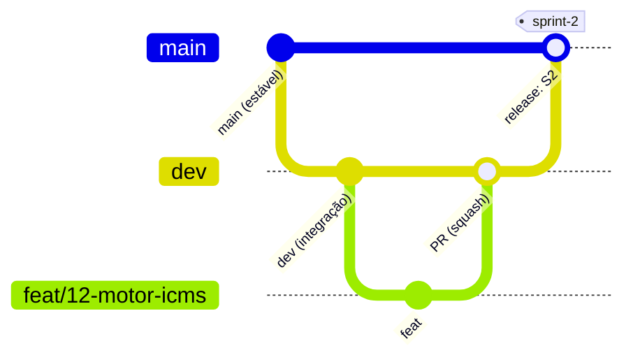

# Como contribuir

## Fluxo de trabalho (gitflow)



| Branch | Para quê | Sai de | Volta por PR para |
|---|---|---|---|
| `main` | Estável e publicado (o site de documentação sai daqui) | | só recebe `dev` ou `hotfix/*` |
| `dev` | Integração do trabalho da sprint. **Branch padrão do repositório** | | `main` (release) |
| `tipo/numero-da-issue-descricao` | Uma issue (ex.: `feat/12-motor-icms`) | `dev` | `dev` (squash) |
| `hotfix/numero-da-issue-descricao` | Correção urgente em algo já na `main` | `main` | `main` e depois `main` → `dev` |

### No dia a dia

1. Pegue uma **issue** do board (ou abra uma com o template `tarefa`, `experimento` ou `bug`).
2. Crie a branch **a partir da `dev`**: `git switch dev && git pull && git switch -c feat/12-motor-icms`.
3. Faça commits pequenos no padrão [Conventional Commits em português](convencoes.md).
4. Abra um **PR pequeno para a `dev`** que fecha a issue (`Closes #12`, que funciona porque a `dev` é a branch padrão).
5. O **par de revisão** da frente revisa. Um code owner precisa aprovar e o CI precisa estar verde.
6. Mudou `packages/contratos/`? Use a label `contrato`: exige **2 aprovações**.
7. Merge com **squash** na `dev`. Nunca há push direto na `dev` nem na `main`.

### Release (fim da sprint)

Depois do gate, abra um PR `dev` → `main` com o título `release: S2`. Use **merge commit** (sem squash) e, depois do merge, crie a tag `sprint-2`. O CI recusa PR para a `main` que não venha da `dev` ou de `hotfix/*`.

## Antes do PR

```bash
uv run ruff check . && uv run ruff format --check .
uv run mypy
uv run pytest
uv run pre-commit run --all-files
```

## Regras de ouro

!!! warning "Privacidade"
    Nunca commite fatura real, segredo, token ou `.env`. Veja a [política de dados](../conformidade/politica-de-dados.md).

- Não invente dados de pesquisa, números ou normas. Use `TODO:`.
- Linguagem de evidência: nada de "ilegal" nem estimativa de restituição.

Veja também [convenções](convencoes.md) e [como rodar](como-rodar.md).
