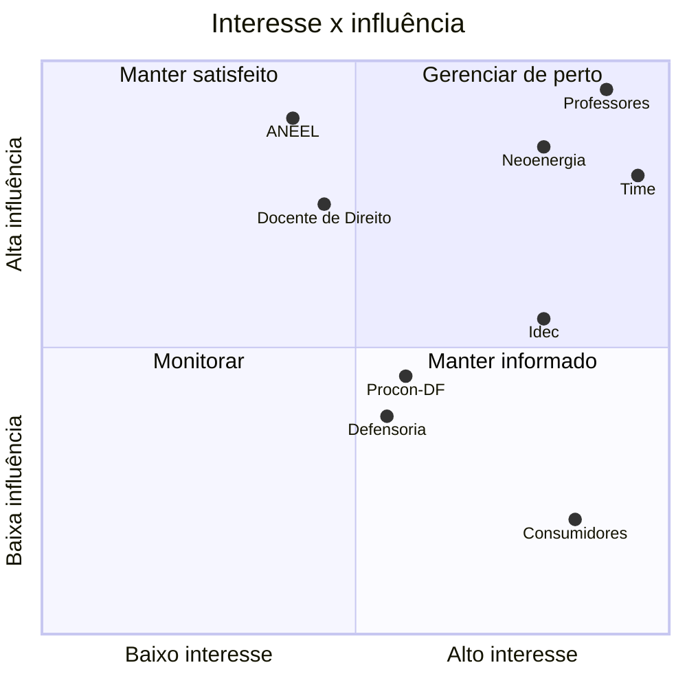

# Mapa de stakeholders

!!! info "Classificação preliminar"
    Leitura do time antes das entrevistas. TODO: revisar com a síntese das entrevistas.

## Tabela

| Stakeholder | Interesse | Influência | O que ganha ou perde | Como engajar |
|---|---|---|---|---|
| Consumidores residenciais (B1, DF) | Alta | Baixa | Ganham clareza sobre a própria fatura e um caminho para pedir esclarecimento. Perdem tempo se houver falso alarme. | Entrevistas, estudo com usuários e cartão de decisão em linguagem simples. |
| Neoenergia Brasília | Alta | Alta | Pode receber mais pedidos de esclarecimento. Ganha quando o pedido chega bem fundamentado e sem acusação. | Linguagem de evidência e minuta de pedido neutra. TODO: decidir se haverá contato direto. |
| ANEEL | Média | Alta | Ganha uma ferramenta aberta que usa suas tabelas e normas. Define as regras que o produto verifica. | Uso das fontes oficiais com vigência e citação por dispositivo. |
| Procon-DF | Média | Média | Pode receber casos mais organizados, com a evidência já reunida. | Encaminhamento do usuário com o cartão de decisão. TODO: avaliar uma apresentação do projeto. |
| Defensoria Pública do DF | Média | Média | Mesmo ganho do Procon-DF para quem precisa de assistência jurídica. | Encaminhamento do usuário. Nenhuma estratégia jurídica no produto. |
| Idec | Alta | Média | Ganha uma ferramenta aberta e auditável alinhada à defesa do consumidor. | Divulgação do benchmark público e do código. TODO: confirmar interesse. |
| Docente de Direito | Média | Alta | Contribui com o parecer que delimita a fronteira jurídica. | Parecer informal (issue #4) e revisão da linguagem de evidência. |
| Professores da disciplina | Alta | Alta | Avaliam as entregas e os gates de cada sprint. | Entregas de sprint, documentação e demonstrações. |
| Time Fatura Aberta | Alta | Alta | Aprende e entrega o projeto. Corre o risco de assumir escopo demais. | Cerimônias das sprints, revisão em par e gates Go/No-Go/Pivot. |

## Matriz interesse × influência

## Leitura

O grupo a gerenciar de perto reúne os professores, o time, a Neoenergia e o Idec. A Neoenergia tem alta influência e é diretamente afetada pelos pedidos de esclarecimento, por isso o produto usa só linguagem de evidência e nunca chama uma cobrança de "ilegal". ANEEL e o docente de Direito devem ser mantidos satisfeitos: um define as regras e o outro delimita o que podemos afirmar. Os consumidores têm o maior interesse e a menor influência. Por isso a voz deles entra pelas entrevistas e pelo estudo com usuários.
