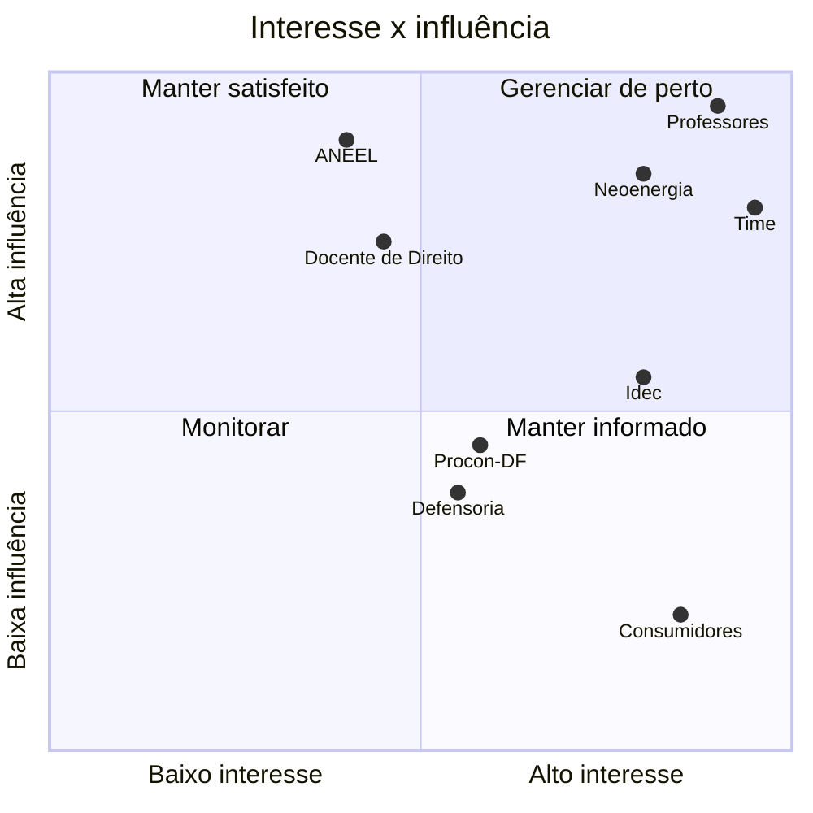

## 3. Mapa de stakeholders

<!-- Responsável: Maria Eduarda · Par de revisão: Luiz · Issue S1-14 · Limite: tabela com pelo menos 8 stakeholders, mais 100 palavras de texto -->

*Matriz executiva de partes interessadas e estratégias de engajamento técnico (Mapeamento: Interesse [I] / Influência [Inf]):*

| Stakeholder | I / Inf | Ganho ou perda | Engajamento |
|---|---|---|---|
| **Consumidores B1 (DF)** | Alta / Baixa | Ganham clareza; perdem tempo se houver falso alarme. | Entrevistas, estudo e linguagem simples. |
| **Neoenergia Brasília** | Alta / Alta | Recebe pedidos fundamentados e sem acusação. | Linguagem de evidência; contato após S2. |
| **ANEEL** | Média / Alta | Ferramenta aberta usa suas tabelas e normas. | Fontes oficiais com vigência e dispositivo. |
| **Procon-DF** | Média / Média | Recebe demandas mais organizadas. | Encaminhamento; apresentação após S6. |
| **Defensoria Pública-DF** | Média / Média | Triagem factual para assistência jurídica. | Encaminhamento; sem tese jurídica no app. |
| **Idec** | Alta / Média | Ferramenta aberta alinhada ao consumidor. | Divulgação do benchmark e código. |
| **Docente de Direito** | Média / Alta | Delimita fronteira informacional vs. jurídica. | Parecer consultivo informal (S1). |
| **Coordenação / docentes** | Alta / Alta | Avaliam entregas e gates de cada sprint. | Sprints, documentação e demos. |
| **Time Fatura Aberta** | Alta / Alta | Aprende e entrega; risco de escopo excessivo. | Cerimônias, revisão em par e gates. |

### Matriz interesse × influência

### Diretrizes de Engajamento por Quadrante

1. **Gerenciar de perto (Alto I / Alta Inf):** Coordenação do programa, time Fatura Aberta, Neoenergia Brasília e Idec.
2. **Manter satisfeito (Médio I / Alta Inf):** ANEEL e Docente de Direito (fronteira normativa).
3. **Manter informado (Alto I / Baixa Inf):** Consumidores B1, cujas dores guiam a interface simples e relatórios neutros baseados em evidência.
