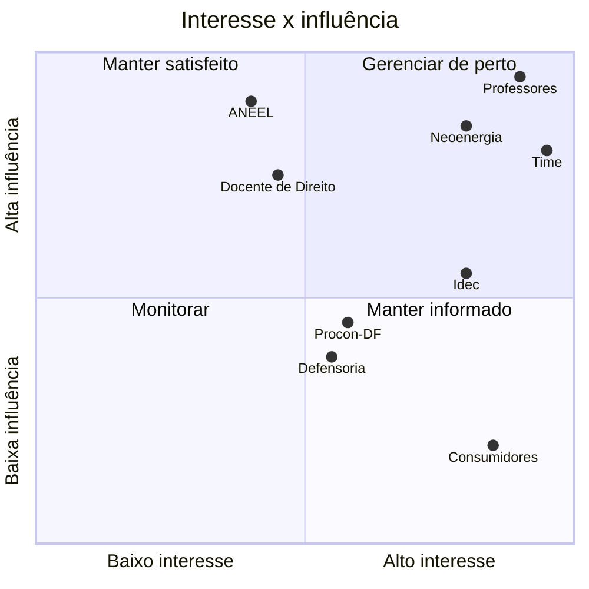

## 3. Mapa de stakeholders

<!-- Responsável: Maria Eduarda · Par de revisão: Luiz · Issue S1-14 · Limite: tabela com pelo menos 8 stakeholders, mais 100 palavras de texto -->

*Matriz executiva de partes interessadas e estratégias de engajamento técnico (Mapeamento: Interesse [I] / Influência [Inf]):*

| Stakeholder | I / Inf | O que ganha ou perde | Como engajar |
|---|---|---|---|
| **Consumidores residenciais B1 (DF)** | Alta / Baixa | Ganham clareza e um caminho para pedir esclarecimento; perdem tempo se houver falso alarme. | Entrevistas, estudo com usuários, linguagem simples. |
| **Neoenergia Brasília** | Alta / Alta | Pode receber mais pedidos de esclarecimento; ganha quando chegam fundamentados e sem acusação. | Linguagem de evidência; contato formal após validar o escopo (S2). |
| **ANEEL** | Média / Alta | Define as tabelas e normas verificadas; ganha uma ferramenta aberta que as usa. | Fontes oficiais com vigência e citação por dispositivo. |
| **Procon-DF** | Média / Média | Pode receber casos mais organizados. | Encaminhamento do usuário; apresentação do projeto após a S6. |
| **Defensoria Pública do DF** | Média / Média | Mesmo ganho, para quem precisa de assistência jurídica. | Encaminhamento; nenhuma estratégia jurídica no produto. |
| **Idec** | Alta / Média | Ganha ferramenta aberta alinhada à defesa do consumidor (interesse a confirmar). | Divulgação do benchmark e do código. |
| **Docente de Direito** | Média / Alta | Delimita a fronteira entre informação e consultoria jurídica. | Parecer consultivo informal. |
| **Professores / coordenação do programa** | Alta / Alta | Avaliam entregas e gates de cada sprint. | Entregas de sprint, documentação, demonstrações. |
| **Time Fatura Aberta** | Alta / Alta | Aprende e entrega; risco de assumir escopo demais. | Cerimônias, revisão em par, gates Go/No-Go/Pivot. |

### Matriz interesse × influência

### Diretrizes de Engajamento por Quadrante

1. **Gestão Ativa (Alto I / Alta Inf):** Coordenação do programa, equipe interna de engenharia, Neoenergia Brasília e Idec.
2. **Manutenção de Satisfação (Médio I / Alta Inf):** ANEEL e Docentes de Direito (orientação normativa).
3. **Monitoramento e Escuta (Alto I / Baixa Inf):** Consumidores residenciais Grupo B1, cujas demandas orientam o design de interface e a clareza da linguagem. O elevado impacto institucional da concessionária reforça a premissa de emitir relatórios estritamente neutros e baseados em evidências técnicas.
