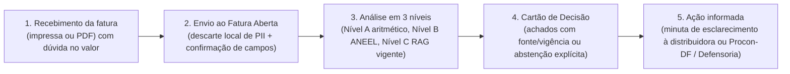

# Lean Inception

Conduzida pela Frente F1 (Produto, Pesquisa e Conformidade) na Sprint 1 e consolidada em reunião no Miro em 30/10/2026, a **Lean Inception** alinhou a visão do produto, as fronteiras de escopo, os perfis de usuários e o sequenciamento do MVP do **Fatura Aberta**. O resultado dos **6 frames** alimenta diretamente o [Pacote de definição (PRD e RFC)](pacote-de-definicao.md), as [Personas](personas.md) e os [Critérios de aceite](criterios-aceite.md).

## Síntese dos 6 Frames

| Frame | Objetivo da dinâmica | Resultado consolidado |
|---|---|---|
| **1. Visão do Produto** | Definir de forma colaborativa o propósito, o público-alvo, o problema central e o diferencial da solução. | **Para** consumidores residenciais do Grupo B1 da Neoenergia Brasília no DF, **cujo** problema é a assimetria de informação e a dificuldade para conferir cálculos, tarifas, bandeiras e tributos na conta de luz, **o Fatura Aberta** é um verificador aberto e auditável **que** analisa a fatura (PDF ou foto) e emite um **cartão de decisão** item a item em três níveis de evidência (`A`, `B` e `C`), com citação exata de ato, dispositivo e vigência. **Diferente de** calculadoras opacas ou serviços de intermediação litigiosa, nosso produto tem código e regras abertos, publica a taxa de falsos alarmes, respeita a fronteira informacional (`RF-15`) e protege dados pessoais (`LGPD`). |
| **2. É / Não é · Faz / Não faz** | Delimitar explicitamente as fronteiras técnicas, regulatórias e jurídicas do escopo inicial. | **É:** plataforma aberta e auditável de apoio à decisão do consumidor B1; verificador aritmético determinístico (Nível A), tarifário (Nível B) e normativo com citação e vigência (Nível C). **Não é:** escritório de advocacia, consultoria jurídica, serviço de intermediação financeira ou aplicativo oficial da distribuidora. **Faz:** extrai e anonimiza dados da fatura com confirmação do usuário; confere leituras, somas, linhas, ICMS e faixa até 80 kWh; confronta TUSD/TE e bandeiras com a tabela oficial da ANEEL; abstém-se quando faltam dados ou norma vigente; gera minuta neutra de pedido de esclarecimento e encaminha ao Procon-DF ou à Defensoria Pública. **Não faz:** não usa o termo *"ilegal"*, não estima valores financeiros de restituição, não peticiona automaticamente e não atende Grupo A, geração distribuída (SCEE), água ou telecomunicações no MVP. |
| **3. Objetivos de Produto e Riscos** | Alinhar metas verificáveis de engenharia/ciência e mapear ameaças críticas com gatilhos de mitigação. | **Objetivos prioritários (articulados com os gates de `planejamento/sprints.yaml`):** *(i)* zero falso alarme nas checagens determinísticas de Nível A em faturas corretas; *(ii)* `recall@5 ≥ 0,70` na recuperação da norma vigente com filtro temporal; *(iii)* redução de afirmações sem suporte com verificação determinística e abstenção formal; *(iv)* zero vazamento de dados pessoais (PII) no repositório e nos logs (`RNF-01`/`RNF-02`). **Riscos e mitigações:** tarifas provisórias ou mudança de layout em maio/2026 mitigadas por versionamento de tabela com data/SHA-256 e etapa de confirmação de campos (`RF-03`); risco de ultrapassar a fronteira jurídica mitigado pela taxonomia `A/B/C` e bloqueio automatizado de expressões vedadas (`RF-15`). |
| **4. Personas** | Caracterizar os perfis representativos de consumidores residenciais do DF e o que esperam do cartão de decisão. | Três personas fictícias consolidadas em [Personas](personas.md): **1. Dona Celina (68 anos, aposentada, Ceilândia):** recebe conta impressa, tem dificuldade com termos técnicos (*bandeira*, *ICMS*) e espera resposta curta e em linguagem simples (`RNF-08`) dizendo se a conta confere e o que fazer; **2. Rafael (24 anos, estudante, Asa Norte):** divide apartamento, desconfia de oscilações de leitura/consumo e espera checagem item a item compartilhável com os colegas; **3. Márcia (45 anos, servidora pública, Taguatinga):** já acionou o Procon-DF, confere contas em planilha e espera citação exata da norma com vigência e minuta de pedido de esclarecimento baseada em evidências. |
| **5. Jornada do Usuário** | Mapear o fluxo ponta a ponta do consumidor antes, durante e após o uso da ferramenta. | **Etapa 1 (Gatilho):** usuário recebe a fatura impressa ou digital com variação ou cobrança que não compreende e normalmente apenas compara com contas anteriores. **Etapa 2 (Entrada e Confirmação):** envia o PDF nativo ou foto da fatura no Fatura Aberta; o sistema descarta dados pessoais (`anonimizar()`) e exibe os campos extraídos para confirmação ou ajuste (`RF-01` a `RF-03`). **Etapa 3 (Verificação e Evidência):** o motor executa as checagens determinísticas de Nível A e de Nível B (tabela ANEEL) e o módulo normativo recupera os dispositivos vigentes aplicáveis (Nível C), aplicando abstenção quando necessário (`RF-04` a `RF-13`). **Etapa 4 (Decisão e Ação):** o usuário lê o **cartão de decisão** (`RF-14`/`RF-15`) com o status de cada item e, se houver indício ou divergência, utiliza a minuta de pedido de esclarecimento junto à distribuidora ou busca orientação no Procon-DF / Defensoria Pública. |
| **6. Brainstorming de Funcionalidades e Sequenciador do MVP** | Priorizar os requisitos funcionais (MoSCoW — *Must Have*) e distribuir as ondas de entrega nas sprints. | **Onda 1 — Fundação e Regras (S1–S2):** contratos congelados v1 (`Fatura`, `Achado`, `Citacao`), tabela ANEEL B1 versionada, parser de PDF com anonimização, motor determinístico de Nível A (`RF-04` a `RF-08`), índice RAG híbrido com filtro de vigência e esqueleto da API (`POST /analisar`). **Onda 2 — Tarifas, Evidência e Agentes (S3–S4):** checagens de Nível B com tabela ANEEL (`RF-09` a `RF-11`), golden set congelado (120 perguntas e 200 faturas sintéticas), avaliação comparativa `B2 × B3`, agentes Analista Normativo e Auditor (`RF-12`, `RF-13`, `RF-15`) e ablação `B4 × B5`. **Onda 3 — Multimodal, Cartão e Validação (S5–S7):** extração de foto com confirmação de campos (`RF-02`/`RF-03`) e defesa contra injeção por imagem (`RNF-03`), interface web com cartão de decisão acessível (`RF-14`, `RNF-08`), minuta de pedido de esclarecimento e estudo final com usuários. |

---

## Detalhamento por Frame

### Frame 1 — Visão do Produto

A construção coletiva da visão partiu do cenário do Grupo B1 residencial no Distrito Federal e da *Big Idea* **"Qualidade de Vida"**:

- **Para:** consumidores residenciais do Grupo B1 da Neoenergia Brasília no Distrito Federal;
- **Cujo:** problema é a assimetria de informação e a falta de meios acessíveis e auditáveis para conferir cálculos aritméticos, tarifas homologadas, adicionais de bandeira e tributos na conta de energia elétrica;
- **O:** **Fatura Aberta**;
- **É um:** verificador aberto, gratuito e auditável de faturas de energia elétrica;
- **Que:** recebe a fatura em PDF ou fotografia, valida os dados sem armazenar informações pessoais e apresenta um **cartão de decisão** estruturado em três níveis de evidência (`Nível A`, `Nível B` e `Nível C`), sempre acompanhado de memória de cálculo ou citação normativa oficial com vigência;
- **Diferente de:** buscadores genéricos, LLMs sem controle de vigência temporal ou plataformas privadas de contestação em massa;
- **Nosso produto:** opera com código, regras e benchmark sintético abertos, adota linguagem estritamente baseada em evidências (sem juízo de ilicitude nem estimativa de restituição) e abstém-se formalmente quando os dados da fatura ou o corpus normativo não permitem confirmar um item.

### Frame 2 — É / Não é · Faz / Não faz

| Dimensão | Definição consolidada |
|---|---|
| **É** | <ul><li>Sistema público e auditável de apoio à decisão do consumidor residencial (Grupo B1 — Neoenergia Brasília).</li><li>Motor determinístico para validação matemática da fatura (**Nível A**) e confronto com tarifas homologadas pela ANEEL (**Nível B**).</li><li>Assistente informativo com recuperação normativa filtrada por vigência temporal e subgrupo tarifário (**Nível C**).</li></ul> |
| **Não é** | <ul><li>Parecer jurídico, consultoria advocatícia ou ferramenta de ajuizamento/peticionamento automático.</li><li>Substituto dos canais oficiais da concessionária, da ANEEL, do Procon-DF ou da Defensoria Pública.</li><li>Repositório de faturas reais (nenhum documento real ou dado pessoal entra no Git).</li></ul> |
| **Faz** | <ul><li>Extrai campos de PDF nativo e foto de fatura, descarta PII (`nome`, `CPF`, `endereço`, `código do cliente/instalação`) e pede confirmação do usuário antes do cálculo (`RF-01` a `RF-03`).</li><li>Executa as 5 checagens aritméticas de **Nível A** (leituras/consumo, soma de itens vs. total, `quantidade × tarifa` por linha e duplicidade, ICMS impresso e decomposição da parcela até `80 kWh`).</li><li>Compara `TUSD`, `TE` e adicional de bandeira com a referência oficial versionada da ANEEL no **Nível B**, citando fonte, data e vigência.</li><li>Responde dúvidas normativas e gera minuta neutra de pedido de esclarecimento à distribuidora no **Nível C**, com abstenção explícita quando faltar suporte.</li></ul> |
| **Não faz** | <ul><li>Não afirma que uma cobrança é *"ilegal"*, *"abusiva"* ou *"crime"*, nem calcula valores de ressarcimento ou indenização (`RF-15`).</li><li>Não analisa faturas de média/alta tensão (Grupo A), micro/minigeração distribuída (SCEE/GD), contas de água (Caesb) ou telecomunicações no escopo do MVP.</li><li>Não retém faturas enviadas pelos usuários após o encerramento da análise (`RNF-01`).</li></ul> |

### Frame 3 — Objetivos de Produto e Riscos

Os objetivos de produto e riscos levantados na Lean Inception foram desdobrados nas metas semanais dos gates de decisão (`Go / No-Go / Pivot`) especificados no planejamento do projeto (`planejamento/sprints.yaml`):

1. **Confiabilidade matemática (meta do Gate S2 em `planejamento/sprints.yaml`):** garantir **zero falso alarme** ($\text{TFA}_{\text{A}} = 0$) nas faturas corretas do benchmark, evitando que o consumidor conteste cobranças regulares por erro da ferramenta.
2. **Rastreabilidade normativa e temporal (metas dos Gates S2 e S3 em `planejamento/sprints.yaml`):** atingir $\text{recall@5} \ge 0,70$ na norma vigente e demonstrar estatisticamente (teste de McNemar e IC 95% via bootstrap) o ganho do filtro de vigência temporal (`B3` vs. `B2`).
3. **Controle de alucinações e fronteira jurídica (meta do Gate S4 em `planejamento/sprints.yaml`):** avaliar o impacto de verificação multiagente (`B4 × B5`) na redução de afirmações sem suporte e garantir 100% de conformidade com o `RF-15`.
4. **Privacidade e segurança por desenho (metas de S1 a S5 em `planejamento/sprints.yaml`):** manter bloqueio automatizado de binários/faturas reais em pre-commit e CI, anonimização na extração e resistência a ataques de injeção de prompt por imagem (`< 5%` de sucesso em 10 faturas maliciosas no Gate S5).

### Frame 4 — Personas

Os três arquétipos construídos na oficina — **Dona Celina** (acessibilidade e linguagem simples na conta impressa), **Rafael** (conferência detalhada de leituras e oscilação de consumo) e **Márcia** (fundamentação normativa com vigência e minuta para pedido de esclarecimento) — foram detalhados em [Personas](personas.md) e validados de forma exploratória pela pesquisa com 21 consumidores do DF e Entorno (`S1-02`), na qual 81,0% relataram usar a conta impressa, 57,1% apontaram dificuldade para entender como os valores são calculados e 85,7% declararam intenção de utilizar gratuitamente uma ferramenta com explicações claras e fontes oficiais.

### Frame 5 — Jornada do Usuário

### Frame 6 — Sequenciador do MVP

| Onda | Sprints | Entregas essenciais do MVP | Critério de validação (Gate) |
|---|---|---|---|
| **Onda 1 — Núcleo Determinístico e Corpus** | S1 e S2 | Pacote de definição (PRD/RFC), contratos v1 congelados, tabela tarifária B1 ANEEL versionada, corpus normativo curado (`REN 1.000/2021`, `CDC`, `Lei Distrital 7.888/2026`), motor de Nível A, parser de PDF B1 e endpoint `POST /analisar`. | `recall@5 ≥ 0,70` em 30 perguntas e `0` falsos alarmes no Nível A. |
| **Onda 2 — Confronto Tarifário e Agentes** | S3 e S4 | Checagens de Nível B com tabela ANEEL, golden set (120 perguntas e 200 faturas sintéticas), avaliação `B2 × B3`, ferramenta de busca com citação, agentes Analista Normativo e Auditor e rodada `B4 × B5`. | Ganho significativo em `B3 × B2` e decisão arquitetural sobre `B4 × B5` sem perda de correção. |
| **Onda 3 — Visão, Interface e Estudo Final** | S5, S6 e S7 | Extração de fotos via VLM local com confirmação do usuário, bateria de segurança contra injeção por imagem, web app completo com cartão de decisão e minuta de pedido de esclarecimento, estudo com 8 a 12 usuários e relatório científico final. | Acurácia por campo em fotos, bloqueio de injeção (`< 5%`), usabilidade e compreensão do cartão na S7. |

---

## Registro da oficina

- **Data e horário:** 30/10/2026, às 19h50 (reunião para finalização do quadro no Miro e conclusão da entrega da Sprint 1).
- **Ferramenta colaborativa:** Quadro compartilhado no Miro e consolidação documental no repositório (`docs/produto/`).
- **Facilitação:** Natalia (`NatyEvelin`, Líder da Frente F1).
- **Participantes:** Natalia (`NatyEvelin`, F1) e Pedro (`pedrohpsantos`, F5).
- **Fotos e anotações (sem dados pessoais):** As notas colaborativas dos post-its virtuais do Miro foram integralmente transcritas e consolidadas na tabela dos 6 frames acima e nas 11 seções do [Pacote de definição (PRD e RFC)](pacote-de-definicao.md), sem inclusão de imagens externas, capturas com identificadores de contas pessoais ou dados de titulares no repositório.
