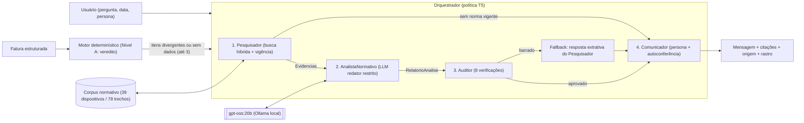
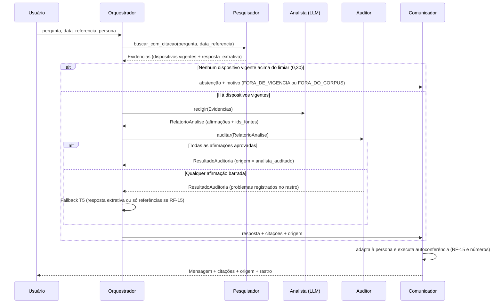
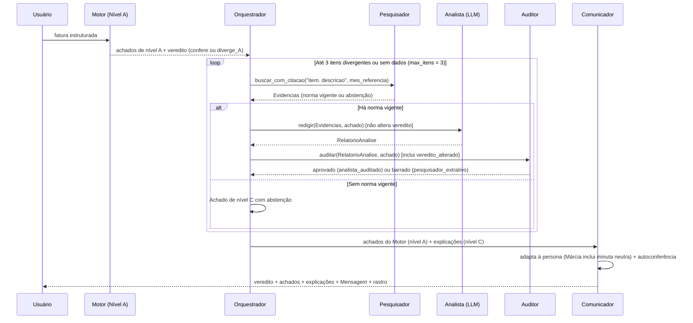

# Relatório Técnico — Sistema Multiagentes do Fatura Aberta (Sprint S4)

| Campo | Referência |
|---|---|
| **Projeto** | Fatura Aberta — verificador aberto de faturas de energia elétrica (Grupo B1, Neoenergia Brasília) |
| **Entrega** | Sprint S4 — Primeira versão multiagentes (política `T5`) |
| **Branch / Commit base** | `dev` (`41b14c4`) |
| **Corpus normativo** | 39 dispositivos conferidos (`78` trechos indexados; SHA-256 `a1007db1…`) |
| **Modelo local avaliado** | `gpt-oss:20b` via Ollama (digest `17052f91a42e`, `temperatura = 0,0`, `semente = 42`) |
| **Data de consolidação** | 19/11/2026 |

## Resumo Executivo

O Fatura Aberta implementa um **sistema multiagentes com 4 agentes especializados coordenados por um Orquestrador** (`Pesquisador`, `AnalistaNormativo`, `Auditor` e `Comunicador`), integrado ao motor determinístico de conferência aritmética (`packages/motor`), ao índice híbrido de busca normativa (`packages/rag`) e à API FastAPI (`POST /perguntar` e `POST /analisar`).

A regra central da arquitetura é: **o LLM apenas redige; toda decisão crítica é determinística.**

- O **Motor** decide se os cálculos internos da fatura conferem (`confere`) ou divergem (`diverge_A`).
- O **Pesquisador** decide se existe norma vigente no corpus para a data de referência.
- O **Auditor** decide se o rascunho redigido pelo LLM tem lastro nas fontes e respeita a fronteira jurídica (`RF-15`).
- O **Orquestrador (política `T5`)** garante que, quando o Auditor barra um rascunho do LLM, o usuário recebe a resposta extrativa literal do Pesquisador (nunca alucinação e sem a perda de acerto da abstenção forçada).

Na avaliação completa com `gpt-oss:20b` sobre as **120 perguntas do golden set** (18/11/2026), a política `T5` alcançou **93,3% de acerto [IC 95%: 88,3%; 97,5%]**, com **0% de afirmações sem suporte** (por construção), **0 citações inventadas**, **0 violações de RF-15** e **0 JSON inválidos** em 106 chamadas ao LLM — superando o Auditor estrito `B5` (`76,7%`, McNemar exato `p = 8,8×10⁻⁵`). Nas **200 faturas sintéticas**, o motor acertou `200/200` vereditos, nenhum rascunho contradisse o motor (`veredito_alterado = 0`) e 100% das mensagens passaram na autoconferência de linguagem e números.

> **Nota sobre reprodução em máquinas sem GPU:** este relatório reúne tanto a **execução real capturada em CPU (modo offline `--llm simulado`)**, que roda em milissegundos em qualquer computador sem Ollama para validar o fluxo de colaboração entre os agentes, quanto as **evidências reais já gravadas com `gpt-oss:20b`** e versionadas na branch `dev`.

---

## 1. Agentes Implementados

O projeto excede o mínimo de 2 agentes especializados ao implementar **4 agentes independentes** — cobrindo todos os papéis de referência (recuperação, análise/síntese, validação e comunicação) — mais o **Orquestrador** que coordena o fluxo e registra a trilha de execução (`Rastro` / `Passo`).

| Agente implementado | Papel equivalente | Usa LLM? | Módulo na branch `dev` |
|---|---|---|---|
| **1. `Pesquisador`** | Recuperação de informações (*Research Agent*) | Não (determinístico) | [`packages/agentes/src/fa_agentes/pesquisador.py`](https://github.com/grupo-8-residencia/Fatura-Aberta/blob/dev/packages/agentes/src/fa_agentes/pesquisador.py) |
| **2. `AnalistaNormativo`** | Análise e síntese de evidências (*Analysis Agent*) | **Sim** (`gpt-oss:20b` local via Ollama) | [`packages/agentes/src/fa_agentes/analista.py`](https://github.com/grupo-8-residencia/Fatura-Aberta/blob/dev/packages/agentes/src/fa_agentes/analista.py) |
| **3. `Auditor`** | Validação e identificação de inconsistências (*Validation Agent*) | Não (8 regras determinísticas; juiz LLM desligado) | [`packages/agentes/src/fa_agentes/auditor.py`](https://github.com/grupo-8-residencia/Fatura-Aberta/blob/dev/packages/agentes/src/fa_agentes/auditor.py) |
| **4. `Comunicador`** | Adaptação da comunicação ao público-alvo (*Communication Agent*) | Não (templates determinísticos + autoconferência) | [`packages/agentes/src/fa_agentes/comunicador.py`](https://github.com/grupo-8-residencia/Fatura-Aberta/blob/dev/packages/agentes/src/fa_agentes/comunicador.py) |
| **`Orquestrador`** | Coordenação do pipeline, política `T5` e rastreamento | Não (coordena os 4 agentes e o Motor) | [`packages/agentes/src/fa_agentes/orquestrador.py`](https://github.com/grupo-8-residencia/Fatura-Aberta/blob/dev/packages/agentes/src/fa_agentes/orquestrador.py) |

### Integração com a Plataforma e API

- **Motor determinístico (`packages/motor`):** executa `analisar_nivel_a(fatura)` (conferência aritmética de leituras, linhas e total) antes dos agentes e emite os achados de nível A e o veredito (`confere` ou `diverge_A`).
- **Índice normativo (`packages/rag`):** `IndiceHibrido` (busca léxica + vetorial) sobre os 39 dispositivos conferidos (78 trechos) com metadados de vigência e subgrupo tarifário.
- **Endpoints HTTP ([`apps/api/src/fa_api/main.py`](https://github.com/grupo-8-residencia/Fatura-Aberta/blob/dev/apps/api/src/fa_api/main.py)):**
  - `POST /perguntar`: recebe `pergunta`, `data_referencia` e `persona`; executa os 4 agentes via `Orquestrador.responder_pergunta` e devolve `resposta`, `mensagem`, `citacoes`, `abstencao`, `origem`, `motivo_abstencao` e `rastro`.
  - `POST /analisar`: executa primeiro o Motor nível A e depois aciona `analisar_com_agentes` para gerar explicações normativas de nível C para até 3 itens divergentes ou sem dados. Possui proteção de tempo (`FA_AGENTES_TIMEOUT_S`, padrão `15 s`) e concorrência (`FA_AGENTES_CONCORRENCIA`, padrão `2`), com degradação graciosa que preserva integralmente os achados do nível A.
  - Ambas as rotas aplicam `Cache-Control: no-store` para não armazenar conteúdo de faturas.

---

## 2. Documentação da Arquitetura e Colaboração

### 2.1 Diagrama da Arquitetura dos Agentes



### 2.2 Responsabilidades e Contratos entre Agentes

Os agentes não compartilham estado global mutável: toda troca de informação ocorre por contratos tipados e imutáveis (`dataclass(frozen=True, slots=True)`), o que permite testar, auditar e substituir cada agente isoladamente.

| Agente | Entrada | O que faz | Saída (contrato) | O que **não** faz |
|---|---|---|---|---|
| **Pesquisador** | `consulta`, `data_referencia` (e `subgrupos=("B1",)`, `top_k=5`, `limiar=0.30`) | Busca híbrida em `IndiceHibrido` com filtro estrito de vigência na data; descarta resultados abaixo de `0,30`; gera a resposta extrativa literal; quando abstém, diferencia `FORA_DE_VIGENCIA` de `FORA_DO_CORPUS`. | `Evidencias` (`dispositivos`, `scores`, `resposta_extrativa`, `motivo_abstencao`) | Não usa LLM; não parafraseia a norma; não responde sem dispositivo vigente acima do limiar. |
| **AnalistaNormativo** | `Evidencias` (+ `Achado` do motor no fluxo de fatura) | Invoca o LLM com `temperatura=0,0`, `semente=42` e saída restrita ao `ESQUEMA_ANALISTA` (JSON com `afirmacoes: [{texto, fontes}]`); resolve `Citacao` diretamente dos dispositivos recuperados. | `RelatorioAnalise` com tupla de `Afirmacao` (`texto`, `ids_fontes`, `citacoes`) | Não acessa o corpus diretamente; não redige citações livremente; não chama o LLM se `Evidencias.abstencao` for verdadeiro; nunca recalcula nem altera o veredito do Motor. |
| **Auditor** | `RelatorioAnalise` (+ `Achado` do motor no fluxo de fatura) | Aplica as 8 verificações ordenadas em cada afirmação; se **qualquer** afirmação falhar, barra o rascunho inteiro e registra os motivos (`Motivo`). | `ResultadoAuditoria` (`resposta`, `problemas`, `afirmacoes_aprovadas`) | Não reescreve texto do LLM; juiz LLM fica desligado após reprovação na calibração (`κ = 0,03` em 13/11 e `κ = −0,14` na metade retida em 18/11). |
| **Comunicador** | Resposta aprovada, extrativa ou abstenção + `Persona` (`celina`, `rafael`, `marcia`) | Formata o texto para a persona (Dona Celina: curto e direto; Rafael: item a item; Márcia: citação completa com vigência e minuta neutra de pedido de esclarecimento) e executa autoconferência (`RF-15` e números novos). | `Mensagem` (`persona`, `texto`, `citacoes`, `adaptada`, `motivo`) | Não usa LLM; não introduz fatos nem números fora da entrada; se a autoconferência falhar, volta ao texto original limpo ou a `texto_so_referencias`. |
| **Orquestrador** | Pergunta + data + persona, ou `Fatura` + achados do Motor | Executa o encadeamento `Pesquisador → Analista → Auditor → Comunicador`, aplica o fallback extrativo da política `T5` (com verificação `RF-15`) e registra cada etapa em `Rastro` (`Passo(agente, acao, detalhe, duracao_s)`). | `RespostaPergunta` ou `ResultadoFatura` (`veredito`, `achados_motor`, `explicacoes`, `origens`, `mensagem`, `rastro`, `motivos_auditor`) | Não altera achados de nível A; limita explicações de fatura a `max_itens = 3` itens divergentes ou sem dados. |

#### As 8 Verificações do `Auditor` (`packages/agentes/src/fa_agentes/auditor.py`)

| Ordem | Verificação determinística | `Motivo` registrado em caso de falha |
|---|---|---|
| 1 | A afirmação aponta pelo menos um `id` de fonte | `sem_citacao` |
| 2 | Todo `id` citado pertence aos dispositivos efetivamente recuperados pelo Pesquisador | `citacao_inventada` |
| 3 | Todo dispositivo citado estava vigente na `data_referencia` | `fora_de_vigencia` |
| 4 | As citações resolvidas conferem exatamente com as dos dispositivos recuperados | `citacao_divergente` |
| 5 | Ausência de expressões vedadas pela regra de fronteira jurídica (`RF-15` em `linguagem.py`) | `linguagem_proibida` |
| 6 | Todo número presente na afirmação existe nas fontes **e** pelo menos `60%` das palavras de conteúdo aparecem nas fontes (`COBERTURA_MINIMA = 0.6`) | `sem_suporte` |
| 7 | No fluxo de fatura, o texto não afirma o oposto do veredito do motor (`contradiz_motor`) | `veredito_alterado` |
| 8 | Juiz LLM opcional (mantido desligado em produção; só poderia rejeitar, nunca aprovar sozinho) | `juiz_rejeitou` |

#### Política `T5` (Fallback Extrativo com Guarda `RF-15`)

Quando o `Auditor` barra um rascunho do `AnalistaNormativo`:

1. Em vez de descartar toda a resposta e abster-se (como ocorria no braço estrito `B5`), o `Orquestrador` recorre à `resposta_extrativa` já produzida pelo `Pesquisador` (`Origem.PESQUISADOR_EXTRATIVO`).
2. Antes de entregar, o `Orquestrador` executa `verificar_linguagem(extr.texto, permitir_citacao_literal=True)`:
   - Trechos literais da norma entre aspas curvas (`“…”`) acompanhados de citação canônica são permitidos pela exceção registrada em 18/11/2026 (a validar com o docente de Direito).
   - Se houver termo vedado fora da exceção literal, o `Orquestrador` substitui a transcrição por `texto_so_referencias(extr.citacoes)`, indicando apenas ato, dispositivo e vigência.
3. Dessa forma, o sistema nunca entrega menos do que o RAG extrativo (`T2`, vencedor da Sprint S3) e só usa redação de LLM quando todas as verificações determinísticas passam.

---

### 2.3 Fluxos de Interação e Colaboração

#### Fluxo 1 — Pergunta Regulatória (`POST /perguntar` e `Orquestrador.responder_pergunta`)



#### Fluxo 2 — Conferência de Fatura (`POST /analisar` e `Orquestrador.analisar_fatura`)



---

## 3. Demonstração do Fluxo Completo

Como o modelo local `gpt-oss:20b` (Ollama) exige recursos de hardware indisponíveis em máquinas comuns, esta demonstração apresenta **duas evidências complementares**:

1. **Parte A — Execução ponta a ponta em modo leve offline (`--llm simulado`):** saída real capturada em CPU (sem GPU e sem Ollama), percorrendo os 5 cenários completos com o rastro de todos os agentes.
2. **Parte B — Evidências reais com `gpt-oss:20b` (Ollama local, 18/11/2026):** exemplos literais e métricas estatísticas extraídos dos arquivos de resultado já versionados na branch `dev` (`avaliacao/resultados/s4-t5.json`, `s4-t5-comparacao.json` e `s4-t5-faturas.json`).

### 3.1 Parte A — Execução Capturada Offline (`scripts/demonstrar_multiagentes.py --llm simulado`)

Comando executado em CPU local (tempo total inferior a 1 segundo, sem necessidade de Ollama):

```bash
uv run python scripts/demonstrar_multiagentes.py --llm simulado
```

> **Transparência metodológica:** no modo `--llm simulado`, o `AnalistaNormativo` usa um cliente simulado que copia a primeira frase do dispositivo recuperado (cenários 1 e 5) ou introduz intencionalmente um número incorreto (cenário 2). O objetivo desse modo é comprovar o encadeamento real entre os 4 agentes, os contratos, o rastro e os bloqueios determinísticos; a avaliação da qualidade do LLM real está na Parte B.

#### Resumo dos 5 cenários executados

| Cenário | Persona | O que demonstra na colaboração entre agentes | Origem final |
|---|---|---|---|
| **1. Pergunta respondida** | `celina` | `Pesquisador` recupera 5 dispositivos vigentes (`ren1000-art-289`); `Analista` redige 1 afirmação; `Auditor` aprova; `Comunicador` adapta em linguagem simples. | `analista_auditado` |
| **2. Rascunho com número errado** | `rafael` | `Analista` propõe afirmação com número divergente; `Auditor` barra por `sem_suporte`; `Orquestrador` aplica o fallback `T5`; `Comunicador` entrega os trechos literais item a item. | `pesquisador_extrativo` |
| **3. Pergunta fora do corpus** | `marcia` | `Pesquisador` retorna 0 dispositivos e diagnostica `FORA_DO_CORPUS`; o LLM **não é chamado**; `Comunicador` informa abstenção justificada. | `abstencao` |
| **4. Data antes da vigência** | `celina` | Em `01/06/2021` (antes da vigência da REN 1.000 em `03/01/2022`), `Pesquisador` detecta norma existente mas não vigente (`FORA_DE_VIGENCIA`); o LLM **não é chamado**. | `abstencao` |
| **5. Fatura com total divergente** | `marcia` | `Motor` analisa 3 itens e emite `diverge_A` (calculado `400.00`, informado `431.00`); agentes recuperam `ren1000-art-327::caput`, auditam a explicação e `Comunicador` gera a minuta neutra de esclarecimento. | `analista_auditado` |

#### Saída literal capturada dos 5 cenários

```text
Sistema multiagentes do Fatura Aberta (LLM: simulado)
Agentes: Pesquisador → Analista → Auditor → Comunicador (Orquestrador, política T5)

== 1. Pergunta respondida (persona: celina, data 09/11/2026)
   Pergunta: Posso ser cobrado pela média quando a distribuidora não consegue ler o medidor?
   [Pesquisador ] buscar_com_citacao: 5 dispositivo(s) vigente(s); ren1000-art-323::caput (0.3633), ren1000-art-289 (0.3421), ren1000-art-260::caput (0.3381), df7888-art-4 (0.3329), ren1000-art-324::caput (0.33)
   [Analista    ] redigir: 1 afirmação(ões) proposta(s)
   [Auditor     ] auditar: aprovou 1 afirmação(ões)
   [Comunicador ] adaptar para celina: adaptada
   Origem da resposta: analista_auditado
   Mensagem final:
     Em resumo: Ocorrendo impedimento de acesso para fins de leitura, a distribuidora deve faturar, observado o § 1º do art. 288: I - demanda ativa: valor contratado, caso aplicável, ou a média aritmética dos valores faturados nos 12 últimos ciclos de faturamento;
     Isso está na REN ANEEL nº 1.000/2021, art. 289.
     Se a sua conta não seguir essa regra, peça explicação à distribuidora.

== 2. Rascunho com número errado (Auditor barra) (persona: rafael, data 09/11/2026)
   Pergunta: Posso ser cobrado pela média quando a distribuidora não consegue ler o medidor?
   [Pesquisador ] buscar_com_citacao: 5 dispositivo(s) vigente(s); ren1000-art-323::caput (0.3633), ren1000-art-289 (0.3421), ren1000-art-260::caput (0.3381), df7888-art-4 (0.3329), ren1000-art-324::caput (0.33)
   [Analista    ] redigir: 1 afirmação(ões) proposta(s)
   [Auditor     ] auditar: barrou o rascunho: sem_suporte
   [Orquestrador] fallback: usa a resposta extrativa do Pesquisador
   [Comunicador ] adaptar para rafael: adaptada
   Origem da resposta: pesquisador_extrativo
   Mensagem final:
     Pergunta: Posso ser cobrado pela média quando a distribuidora não consegue ler o medidor?
     O que a norma diz, ponto a ponto:
     - “Art. 323. A distribuidora, no caso de faturar valores incorretos, não apresentar fatura ou faturar sem utilizar a leitura do sistema de medição nos casos em que não haja previsão nesta Resolução, sem prejuízo das penalidades cabíveis, deve observar os seguintes procedimentos: I - faturamento a menor ou ausência de faturamento: cobrar do consumidor e demais usuários as quantias não recebidas, limitando-se aos últimos…” [REN ANEEL nº 1.000/2021, art. 323, caput]
     - “Art. 289. Ocorrendo impedimento de acesso para fins de leitura, a distribuidora deve faturar, observado o § 1º do art. 288: I - demanda ativa: valor contratado, caso aplicável, ou a média aritmética dos valores faturados nos 12 últimos ciclos de faturamento; e II - demais grandezas elétricas: médias aritméticas dos valores faturados nos 12 últimos ciclos de faturamento.” [REN ANEEL nº 1.000/2021, art. 289]
     - “Art. 260. A leitura do sistema de medição para o grupo B deve ser realizada em intervalos de aproximadamente 30 dias, observados o mínimo de 27 e o máximo de 33 dias, de acordo com o calendário de leitura.” [REN ANEEL nº 1.000/2021, art. 260, caput]

== 3. Fora do corpus (persona: marcia, data 09/11/2026)
   Pergunta: Como declarar criptomoedas no imposto de renda?
   [Pesquisador ] buscar_com_citacao: 0 dispositivo(s) vigente(s); abstenção: nenhum dispositivo do corpus cobre a consulta acima do limiar
   [Comunicador ] adaptar para marcia: adaptada
   Origem da resposta: abstencao
   Mensagem final:
     O sistema se absteve: não há dispositivo vigente no corpus que sustente uma resposta (nenhum dispositivo do corpus cobre a consulta acima do limiar). Não respondemos sem fonte.

== 4. Antes da vigência da norma (persona: celina, data 01/06/2021)
   Pergunta: Quantos ciclos entram na média quando o medidor não foi lido?
   [Pesquisador ] buscar_com_citacao: 0 dispositivo(s) vigente(s); abstenção: há dispositivo sobre o tema no corpus, mas nenhum vigente na data
   [Comunicador ] adaptar para celina: adaptada
   Origem da resposta: abstencao
   Mensagem final:
     Não encontrei uma regra em vigor que responda a isso com segurança. Para essa dúvida, procure a distribuidora ou o Procon-DF.

== 5. Fatura com total divergente (persona: marcia)
   [Motor       ] analisar_nivel_a: 3 achado(s)
   [Motor       ] veredito: diverge_A
   [Pesquisador ] buscar_com_citacao: 1 dispositivo(s) vigente(s); ren1000-art-327::caput (0.4155)
   [Analista    ] redigir: 1 afirmação(ões) proposta(s)
   [Auditor     ] auditar: aprovou 1 afirmação(ões)
   [Comunicador ] adaptar para marcia: adaptada
   Veredito do motor: diverge_A; explicações: {'Total da fatura': 'analista_auditado'}
   Mensagem final:
     Resultado da conferência determinística (nível A):
     - Consumo medido: A diferença entre as leituras confere com o consumo informado.
     - Total da fatura: A soma das linhas não confere com o total informado.
       Norma aplicável: REN ANEEL nº 1.000/2021, art. 327, caput (vigente desde 03/01/2022)
     - Linha: Consumo de energia: O valor da linha 'Consumo de energia' confere com o produto entre quantidade e tarifa.

     Minuta de pedido de esclarecimento (linguagem neutra):
     Solicito esclarecimento sobre os itens abaixo da minha fatura, em que o valor informado difere do calculado a partir dos próprios dados da fatura:
     - Total da fatura: calculado 400.00; informado 431.00.
     Peço que a resposta indique a regra aplicada, considerando: REN ANEEL nº 1.000/2021, art. 327, caput.
```

---

### 3.2 Parte B — Evidências Reais Gravadas com `gpt-oss:20b` (Ollama Local, 18/11/2026)

Os casos abaixo foram extraídos diretamente dos arquivos versionados em [`avaliacao/resultados/s4-t5.json`](https://github.com/grupo-8-residencia/Fatura-Aberta/blob/dev/avaliacao/resultados/s4-t5.json), [`s4-t5-comparacao.json`](https://github.com/grupo-8-residencia/Fatura-Aberta/blob/dev/avaliacao/resultados/s4-t5-comparacao.json) e [`s4-t5-faturas.json`](https://github.com/grupo-8-residencia/Fatura-Aberta/blob/dev/avaliacao/resultados/s4-t5-faturas.json), gerados em rodada real com `gpt-oss:20b` (`17052f91a42e`, `temperatura = 0,0`, `semente = 42`).

#### Caso real 1 — Rascunho do `gpt-oss:20b` aprovado pelo Auditor (`GS-Q001`)

- **Pergunta (`data_referencia = 2026-11-09`, subgrupo `B1`):** *"Quem pode ser classificado na subclasse residencial baixa renda (tarifa social)?"*
- **Pesquisador:** recuperou 4 dispositivos vigentes (`ren1000-art-177`, `ren1000-art-358`, `ren1000-art-290::p3`, `reh3614-tab2-b1`).
- **Analista (`gpt-oss:20b`, `23,29 s`, `228` tokens, JSON válido na 1ª tentativa):** propôs 3 afirmações curtas apontando `["ren1000-art-177"]`:
  1. *"A unidade consumidora pode ser classificada na subclasse residencial baixa renda se for utilizada por família inscrita no Cadastro Único para Programas Sociais do Governo Federal (CadÚnico) com renda familiar mensal por pessoa menor ou igual a meio salário-mínimo nacional."*
  2. *"A unidade consumidora pode ser classificada na subclasse residencial baixa renda se for utilizada por idosos com 65 anos ou mais ou pessoas com deficiência que recebam o Benefício de Prestação Continuada da Assistência Social (BPC)."*
  3. *"A unidade consumidora pode ser classificada na subclasse residencial baixa renda se for utilizada por família inscrita no CadÚnico que possua renda mensal menor ou igual a três salários-mínimos e portador de doença ou deficiência cujo tratamento, procedimento médico ou terapêutico requeira o uso continuado de aparelhos, equipamentos ou instrumentos que demandem consumo de energia elétrica."*
- **Auditor:** aprovou todas as 3 afirmações (`0` sem suporte, `0` citações inventadas, `0` violações `RF-15`).
- **Resultado (`T5`):** `origem = analista_auditado`, `cita_canonico = true`, **`acerto = true`**.

#### Caso real 2 — Auditor barra rascunho do `gpt-oss:20b` e `T5` recupera via fallback extrativo (`GS-Q034`)

- **Pergunta (`data_referencia = 2026-11-09`):** *"A distribuidora pode faturar sem usar a leitura do medidor?"*
- **Pesquisador:** recuperou 5 dispositivos vigentes (`ren1000-art-323::caput`, `ren1000-art-324::caput`, `ren1000-art-260::p2`, `ren1000-art-260::p1`, `ren1000-art-260::caput`).
- **Analista (`gpt-oss:20b`, `19,09 s`, `79` tokens):** redigiu *"A distribuidora pode faturar sem utilizar a leitura do sistema de medição, desde que observe os procedimentos previstos nos arts. 323 e 324 da REN ANEEL nº 1.000/2021."* apontando `["ren1000-art-323::caput", "ren1000-art-324::caput"]`.
- **Auditor:** barrou por `sem_suporte` (os números `"1.000"` e `"2021"` do nome do ato não aparecem no corpo literal do dispositivo).
- **Comparação direta entre braços neste caso:**
  - `B4` (sem Auditor): emitiu a afirmação, mas registrou `emitiu_sem_suporte = true`.
  - `B5` (Auditor estrito): converteu o bloqueio em abstenção e **errou** (`acerto = false`).
  - **`T5` (política adotada):** acionou o fallback para a resposta extrativa do Pesquisador (`origem = pesquisador_extrativo`, `3` trechos citando `ren1000-art-323::caput`, `ren1000-art-324::caput` e `ren1000-art-260::p2`), manteve `0` afirmações sem suporte e **acertou** (`acerto = true`).

#### Caso real 3 — Abstenção do Pesquisador sem chamada ao LLM (`GS-Q069`)

- **Pergunta (`tipo = fora_do_corpus`, `data_referencia = 2026-11-09`):** *"Quem define o valor da contribuição de iluminação pública no Distrito Federal?"*
- **Pesquisador:** `0` dispositivos acima do limiar (`0,30`); registrou `motivo_abstencao = "nenhum dispositivo do corpus cobre a consulta acima do limiar"`.
- **Analista:** **não acionou o LLM** (`chamou_llm = false`, `duracao_s = 0,0 s`, `tokens_saida = 0`).
- **Resultado (`T5`):** `origem = abstencao`, `abstencao = true`, **`acerto = true`**.

#### Caso real 4 — Fatura sintética divergente (`GS-F018`, persona `marcia`)

- **Entrada (`GS-F018`, `mes_referencia = 2026-06-01`, Grupo `B1`, Neoenergia Brasília, dados 100% sintéticos):**
  - Leituras: `38228` → `38435` (`207 kWh` conferem).
  - Linha `"Consumo de energia"` (anomalia injetada `item_energia_incoerente`): `207 kWh × R$ 0,80 = R$ 165,60` esperados vs `R$ 190,44` informados.
  - Demais linhas: `"Adicional de bandeira"` (`207 × R$ 0,05 = R$ 10,35`) e `"Contribuição municipal (sintética)"` (`R$ 12,00`), somando `R$ 212,79`.
- **Motor determinístico (Nível A):** emitiu `veredito = diverge_A` (`acerto = true`).
- **Agentes (Nível C, `1` chamada ao `gpt-oss:20b`, `16,82 s`):**
  - `"Linha: Consumo de energia"` → `origem = analista_auditado` (explicação normativa aprovada pelo Auditor, `0` problemas, `veredito_alterado` não disparado).
  - `"ICMS"` → `origem = abstencao` (o corpus normativo não contém norma tributária de ICMS).
- **Comunicador (`marcia`):** `mensagem_adaptada = true`, `0` violações `RF-15` na mensagem e nas explicações.

---

### 3.3 Métricas Consolidadas da Rodada Real (`gpt-oss:20b`)

#### 120 perguntas do Golden Set (`avaliacao/resultados/s4-t5-comparacao.json`)

Cobertura `120/120`, `106` chamadas ao `gpt-oss:20b` (`14` abstenções diretas sem chamar LLM), **`0` JSON inválido**, latência média `15,04 s` por chamada ao LLM.

| Braço | Acerto [IC 95%] | Taxa de abstenção | Respostas com afirmação sem suporte | Violações `RF-15` | Citação inventada | Fora de vigência |
|---|---|---|---|---|---|---|
| `B4` (Analista sem Auditor) | `90,0% [84,2%; 95,0%]` | `20,0%` | `14,2% [8,3%; 20,8%]` | `2` | `1` | `0` |
| `B5` (Auditor estrito) | `76,7% [69,2%; 84,2%]` | `34,2%` | `0,0%` (por construção) | `0` | `0` | `0` |
| `B5_estrutural` (sem cobertura de palavras) | `79,2% [71,7%; 85,8%]` | `31,7%` | `2,5% [0,0%; 5,8%]` | `0` | `0` | `0` |
| `T2` (extrativo do Pesquisador, sem LLM) | `91,7% [86,7%; 96,7%]` | `11,7%` | `0,0%` (trecho literal) | `0` | `0` | `0` |
| **`T5` (4 agentes com fallback extrativo)** | **`93,3% [88,3%; 97,5%]`** | **`11,7%`** | **`0,0%` (por construção)** | **`0`** | **`0`** | **`0`** |

- **Distribuição de origem no `T5`:** `79` `analista_auditado`, `27` `pesquisador_extrativo`, `14` `abstencao`.
- **Acerto por tipo no `T5`:** `normativa = 96,9%`, `vigencia = 83,3%`, `lacuna = 83,3%`, `fora_do_corpus = 60,0%`.
- **Testes pareados de McNemar (exato, `n = 120`):**
  - `B4 × B5`: `16 × 0` (`p = 3,1×10⁻⁵`) — confirma perda significativa de acerto quando o Auditor força abstenção.
  - `T5 × B5`: `23 × 3` (`p = 8,8×10⁻⁵`) — confirma ganho estatisticamente significativo do fallback extrativo sobre o Auditor estrito.
  - `T5 × B4`: `7 × 3` (`p = 0,34`, não significativo) — empata em acerto com `B4`, eliminando as afirmações sem suporte medidas pelo Auditor.
  - `T5 × T2`: `2 × 0` (`p = 0,50`, não significativo) — mantém o piso do extrativo acrescentando redação concisa nas 79 perguntas aprovadas.

#### 200 faturas sintéticas (`avaliacao/resultados/s4-t5-faturas.json`)

| Indicador (persona `marcia`, `max_itens = 3`) | Valor medido |
|---|---|
| Acerto do veredito do Motor (`confere` / `diverge_A`) | `200 / 200` (`100%`; `0%` falso alarme — circular no conjunto sintético) |
| Total de itens explicados pelos agentes (nível C) | `284` (`18` `analista_auditado`, `66` `pesquisador_extrativo`, `200` `abstencao` em ICMS) |
| Bloqueios do Auditor por `sem_suporte` | `33` (recuperados via fallback extrativo) |
| Bloqueios por `veredito_alterado` (contradição ao Motor) | **`0`** |
| Violações de `RF-15` (mensagens e explicações) | **`0`** |
| Mensagens não adaptadas na autoconferência do Comunicador | **`0`** |
| Chamadas ao LLM / Latência média nas faturas com LLM | `84` chamadas / `15,69 s` |

---

## 4. Conformidade, Limitações e Referências

### Fronteira Jurídica (`RF-15`) e Privacidade (LGPD)

- **Linguagem de evidência (`RF-15`):** o módulo [`linguagem.py`](https://github.com/grupo-8-residencia/Fatura-Aberta/blob/dev/packages/agentes/src/fa_agentes/linguagem.py) bloqueia três categorias de termos proibidos (`qualificacao_juridica`, `reparacao_financeira` e `aconselhamento_processual`), garantindo que o sistema descreva divergências e normas aplicáveis sem declarar ilegalidade, estimar restituição ou orientar ação judicial.
- **Privacidade e dados sintéticos:** todos os exemplos e as 200 faturas avaliadas são integralmente sintéticos, sem dados pessoais ou faturas reais, e os endpoints da API operam com retenção zero (`Cache-Control: no-store`).

### Limitações Conhecidas

1. **Taxa de `0%` sem suporte por construção:** `B5` e `T5` emitem apenas afirmações que passam nas verificações determinísticas do `Auditor` (ou trechos literais da norma). Erros factuais ou de relevância que passem por essas regras exigem revisão humana (o juiz LLM foi reprovado na calibração).
2. **Níveis absolutos no golden set:** o limiar `0,30` e ajustes de recuperação usaram erros do próprio golden set na Sprint S3; os níveis absolutos devem ser lidos como otimistas, enquanto as comparações entre braços (`B4`, `B5`, `T2`, `T5`) são pareadas.
3. **Latência do LLM local:** `15,04 s` em média nas perguntas e `15,69 s` nas faturas com LLM (`gpt-oss:20b` via Ollama). Em máquinas sem GPU ou quando o tempo limite da API (`FA_AGENTES_TIMEOUT_S`) é excedido, o sistema degrada graciosamente para o nível A / modo extrativo em milissegundos.
4. **Legibilidade com usuários reais (`RNF-08`):** o `Comunicador` usa templates determinísticos por persona; o teste de compreensão com usuários reais está planejado para a Sprint S7.

### Documentação Relacionada no Repositório

- [Arquitetura do sistema multiagentes](../arquitetura/agentes.md)
- [Planejamento e retrospectiva da Sprint S4](s4.md)
- [Relatório científico S4 (`B4 × B5` e rodada `T5`)](../avaliacao/relatorio-s4.md)
- [Personas do produto](../produto/personas.md)
- [Fronteira jurídica (`RF-15`)](../conformidade/fronteira-juridica.md)
- Script da demonstração: [`scripts/demonstrar_multiagentes.py`](https://github.com/grupo-8-residencia/Fatura-Aberta/blob/dev/scripts/demonstrar_multiagentes.py)
